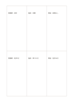

# 二行三列のマトリクス

`matrix-2x3` · `matrix` · `a5-draft`

[繁體中文](README.zh-TW.md) · [English](README.en.md) · [日本語](README.ja.md) · [一覧へ戻る](../../docs/ja/catalog.md)

二つの条件と三つの選択肢が交わる六つのマスに記録します。

## 向いている場面

- 三会場を設備と交通の二条件で比べるとき。
- 三資料が二つの問いにどう答えるか整理するとき。

## 使い方

1. 二行と三列が表すものを自分で決めます。
2. 各交点のマスに短い根拠だけを書きます。
3. 横と縦の両方向に読み、情報の欠けを探します。

## 記入後に見えること

複数の観点が交わる場所と、空白や選択上の差が見えます。

## 記入例

架空の読書会で図書館、地域センター、東屋を三列に、設備と交通を二行に置いています。

[SVG](examples/ja.svg)

## 向いていない場面

マスは段落には狭く、数値評価には単位の明示が必要です。

## ダウンロード

- [文字なしSVG](exports/a5-draft/blank.svg)
- [文字なしPDF](exports/a5-draft/blank.pdf)
- [左上に英語名があるPDF](exports/a5-draft/titled.pdf)
- [濃い線の文字なしPDF](exports/a5-contrast/blank.pdf)
- [濃い線のSVG](exports/a5-contrast/blank.svg)

英語名は表題付きPDFだけに印刷され、文字なし版は自由な記入に使えます。

用紙サイズ：A5（148 × 210 mm）。設定ファイル：`a5-draft`。

## 由来と状態

一般的な幾何構造 · 詳しい由来の記録： [manifest.json](manifest.json)  
[MITライセンスの範囲](../../LICENSE-SCOPE.md)

[三言語の用語集](../../docs/ja/glossary.md)

## 変更と再生成

`profiles/a5-draft.json` または `src/noteformats/layouts/` の描画関数を変更し、プロジェクトのルートで実行します：

`python scripts/build.py --ids matrix-2x3`
