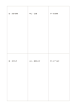

# 二列三欄矩陣

`matrix-2x3` · `matrix` · `a5-draft`

[繁體中文](README.zh-TW.md) · [English](README.en.md) · [日本語](README.ja.md) · [返回目錄](../../docs/zh-TW/catalog.md)

用六個相連格記兩類條件與三種選項的交會。

## 適合情境

- 比較三個場地在設備與交通兩項條件下的情況。
- 整理三篇資料對兩個問題的回應。

## 使用步驟

1. 先在紙上自訂兩列與三欄的意思。
2. 每格只記該列與該欄交會的短證據。
3. 橫向與縱向各讀一次，找出資料缺口。

## 整理後可得到

看見兩個以上維度交叉處的資料缺口與取捨。

## 實際填寫示例

示例把虛構讀書會的圖書館、社區中心、戶外亭放三欄，設備與交通放兩列。

[SVG](examples/zh-TW.svg)

## 不適合情境

每格寬度有限，不宜放完整段落；若需要精確分數請標明單位。

## 下載

- [無字 SVG](exports/a5-draft/blank.svg)
- [無字 PDF](exports/a5-draft/blank.pdf)
- [左上角英文名稱 PDF](exports/a5-draft/titled.pdf)
- [深色墨線無字 PDF](exports/a5-contrast/blank.pdf)
- [深色墨線 SVG](exports/a5-contrast/blank.svg)

英文名稱只印在標題版 PDF；無字版仍適合自由列印與改作。

頁面尺寸：A5（148 × 210 mm）；設定檔：`a5-draft`。

## 來源與狀態

通用幾何結構 · 詳細來源紀錄見 [manifest.json](manifest.json)  
[MIT 授權範圍](../../LICENSE-SCOPE.md)

[三語術語表](../../docs/zh-TW/glossary.md)

## 修改與重新生成

修改 `profiles/a5-draft.json` 或 `src/noteformats/layouts/` 內對應的繪圖函式，再於專案根目錄執行：

`python scripts/build.py --ids matrix-2x3`
