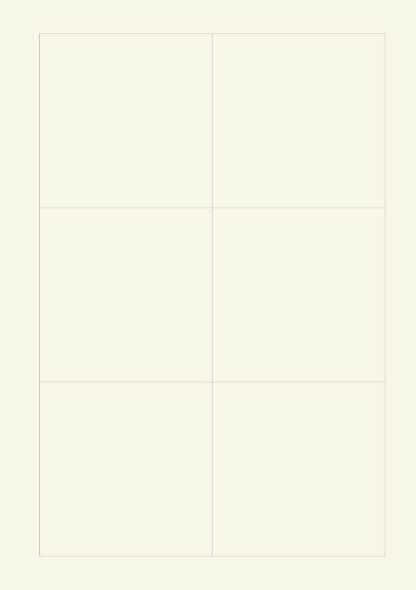
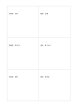

# 二列三行の比較表

`matrix-3x2` · `matrix` · `a5-draft`

[繁體中文](README.zh-TW.md) · [English](README.en.md) · [日本語](README.ja.md) · [一覧へ戻る](../../docs/ja/catalog.md)

一方に案、もう一方に条件を決め、交差するマスを埋めます。 図形の変更： 行列の列数×行数: 2×3.

## 向いている場面

**図形の対応:** `parameter` · [matrix-2x3](../matrix-2x3/README.ja.md)

- 三行に会場、二列に設備と交通条件を割り当て、交点を埋めるとき。
- 三つの資料が二つの問いにどう答えるかを、問いごとの列で比べるとき。

## 使い方

1. 行と列に異なる比較軸を決め、交点の情報を記入します。
2. 記入例を参考に、領域の順で記します：1「図書館：投影」；2「施設：音響」；3「図書館：徒歩5分」；4「施設：車で15分」；5「図書館：無料」；6「施設：低料金」
3. 各領域を読み返し、未確認の点と次の行動を記します。

## 記入後に見えること

複数の観点が交わる場所と、空白や選択上の差が見えます。

## 記入例

図の記入位置の順に示します。番号一つが一つの記入例です：

1. 図書館：投影
2. 施設：音響
3. 図書館：徒歩5分
4. 施設：車で15分
5. 図書館：無料
6. 施設：低料金

[SVG](examples/ja.svg)

## 向いていない場面

三行二列で扱える交点は六つです。観点が増えたら複数の問いを一マスに押し込まず領域を増やし、数値の単位や尺度をそろえます。

## ダウンロード

- [文字なしSVG](exports/a5-draft/blank.svg)
- [文字なしPDF](exports/a5-draft/blank.pdf)
- [左上に英語名があるPDF](exports/a5-draft/titled.pdf)
- [濃い線の文字なしPDF](exports/a5-contrast/blank.pdf)
- [濃い線のSVG](exports/a5-contrast/blank.svg)

英語名は表題付きPDFだけに印刷され、文字なし版は自由な記入に使えます。

用紙サイズ：A5（148 × 210 mm）。設定ファイル：`a5-draft`。

## 由来と状態

一般的な幾何構造 · 詳しい由来の記録： [manifest.json](manifest.json)  
[MITライセンスの範囲](../../LICENSE-SCOPE.md)

[三言語の用語集](../../docs/ja/glossary.md)

## 変更と再生成

図形は `src/noteformats/variants.py`、文章は `src/noteformats/variant_content.py` を変更し、プロジェクトのルートで実行します：

`python scripts/build.py --ids matrix-3x2`
