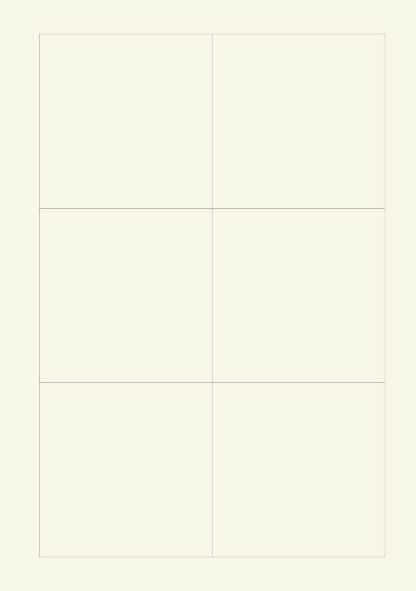
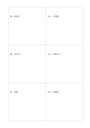

# 二欄三行比較矩陣

`matrix-3x2` · `matrix` · `a5-draft`

[繁體中文](README.zh-TW.md) · [English](README.en.md) · [日本語](README.ja.md) · [返回目錄](../../docs/zh-TW/catalog.md)

先定義橫向方案與縱向條件，再逐格記錄交叉資訊。 本款的幾何變化： 矩陣的欄乘列: 2×3.

## 適合情境

**幾何對照:** `parameter` · [matrix-2x3](../matrix-2x3/README.zh-TW.md)

- 用三列代表三個場地、兩欄代表設備與交通條件，逐格填資料。
- 比較三份資料對兩個問題的回答，讓同一問題保持在同一欄。

## 使用步驟

1. 先為列與欄設定不同的比較維度，再逐格填入交叉處的資料。
2. 參考本頁示例，各區依序記錄：1「館：有投影」；2「中心：有音響」；3「館：步行5分」；4「中心：車程15分」；5「館：免費」；6「中心：低費用」
3. 回看各區，標記仍待查證的內容，再決定下一步。

## 整理後可得到

看見兩個以上維度交叉處的資料缺口與取捨。

## 實際填寫示例

依圖中填寫位置順序列出，每個編號是一筆示例條目：

1. 館：有投影
2. 中心：有音響
3. 館：步行5分
4. 中心：車程15分
5. 館：免費
6. 中心：低費用

[SVG](examples/zh-TW.svg)

## 不適合情境

三列兩欄只提供六個交叉位置；比較維度增加時不宜把多個問題硬塞同格，數值也須維持相同單位與尺度。

## 下載

- [無字 SVG](exports/a5-draft/blank.svg)
- [無字 PDF](exports/a5-draft/blank.pdf)
- [左上角英文名稱 PDF](exports/a5-draft/titled.pdf)
- [深色墨線無字 PDF](exports/a5-contrast/blank.pdf)
- [深色墨線 SVG](exports/a5-contrast/blank.svg)

英文名稱只印在標題版 PDF；無字版仍適合自由列印與改作。

頁面尺寸：A5（148 × 210 mm）；設定檔：`a5-draft`。

## 來源與狀態

通用幾何結構 · 詳細來源紀錄見 [manifest.json](manifest.json)  
[MIT 授權範圍](../../LICENSE-SCOPE.md)

[三語術語表](../../docs/zh-TW/glossary.md)

## 修改與重新生成

調整 `src/noteformats/variants.py` 的幾何或 `src/noteformats/variant_content.py` 的文字，再於專案根目錄執行：

`python scripts/build.py --ids matrix-3x2`
