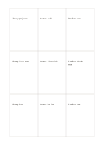

# Three-by-three comparison matrix

`matrix-3x3` · `matrix` · `a5-draft`

[繁體中文](README.zh-TW.md) · [English](README.en.md) · [日本語](README.ja.md) · [Back to catalog](../../docs/en/catalog.md)

Use nine equal adjoining cells for three options crossed with three criteria, without a mandala's center-outward idea behavior.

## When to use it

**Geometry relationship:** `independent` · [mandala-3x3](../mandala-3x3/README.en.md)

- Compare equipment, travel, and cost for three venues.
- Check how three sources answer the same three questions.

## How to use it

1. Define three column options and three row criteria in your own notes.
2. Put brief evidence for each intersection in its cell; leave missing data blank.
3. Compare across rows and columns while recording sources and units separately.

## What the page helps you see

Intersections, missing cells, and tradeoffs across chosen dimensions.

## Worked example

A fictional library, community center, and pavilion are checked across equipment, travel, and cost, with each cell holding a short item to verify.

[SVG](examples/en.svg)

## When not to use it

Nine cells do not imply a central topic; precise scores require units and weighting outside this sheet.

## Downloads

- [Wordless SVG](exports/a5-draft/blank.svg)
- [Wordless PDF](exports/a5-draft/blank.pdf)
- [PDF with English name at top left](exports/a5-draft/titled.pdf)
- [Darker-ink wordless PDF](exports/a5-contrast/blank.pdf)
- [Darker-ink SVG](exports/a5-contrast/blank.svg)

The English name appears only on the titled PDF; the wordless version remains available for free writing.

Page size: A5 (148 × 210 mm); profile: `a5-draft`.

## Provenance and status

Adaptation of an existing method · Detailed source record: [manifest.json](manifest.json)  
[MIT license scope](../../LICENSE-SCOPE.md)

[Trilingual glossary](../../docs/en/glossary.md)

## Modify and rebuild

Edit geometry in `src/noteformats/variants.py` or text in `src/noteformats/variant_content.py`, then run from the project root:

`python scripts/build.py --ids matrix-3x3`
