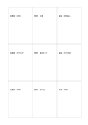

# 三行三列の比較表

`matrix-3x3` · `matrix` · `a5-draft`

[繁體中文](README.zh-TW.md) · [English](README.en.md) · [日本語](README.ja.md) · [一覧へ戻る](../../docs/ja/catalog.md)

九つの同じ大きさのマスで三案と三条件を交差させ、中心から広げる九宮の使い方とは分けます。

## 向いている場面

**図形の対応:** `independent` · [mandala-3x3](../mandala-3x3/README.ja.md)

- 三会場の設備、交通、費用を比べる場合。
- 三つの資料が同じ三問にどう答えるか調べる場合。

## 使い方

1. 三列の案と三行の条件を自分のメモで定めます。
2. 交差するマスに短い根拠を書き、不明な箇所は空けておきます。
3. 行と列を見比べ、出典や単位は別に記します。

## 記入後に見えること

複数の観点が交わる場所と、空白や選択上の差が見えます。

## 記入例

架空の図書館、地域施設、東屋について、設備、交通、費用の各マスに確かめる短い記録を置きます。

[SVG](examples/ja.svg)

## 向いていない場面

九マスだけでは中心テーマを示しません。正確な採点には単位と重みが必要です。

## ダウンロード

- [文字なしSVG](exports/a5-draft/blank.svg)
- [文字なしPDF](exports/a5-draft/blank.pdf)
- [左上に英語名があるPDF](exports/a5-draft/titled.pdf)
- [濃い線の文字なしPDF](exports/a5-contrast/blank.pdf)
- [濃い線のSVG](exports/a5-contrast/blank.svg)

英語名は表題付きPDFだけに印刷され、文字なし版は自由な記入に使えます。

用紙サイズ：A5（148 × 210 mm）。設定ファイル：`a5-draft`。

## 由来と状態

既存の方法を配置に応用 · 詳しい由来の記録： [manifest.json](manifest.json)  
[MITライセンスの範囲](../../LICENSE-SCOPE.md)

[三言語の用語集](../../docs/ja/glossary.md)

## 変更と再生成

図形は `src/noteformats/variants.py`、文章は `src/noteformats/variant_content.py` を変更し、プロジェクトのルートで実行します：

`python scripts/build.py --ids matrix-3x3`
