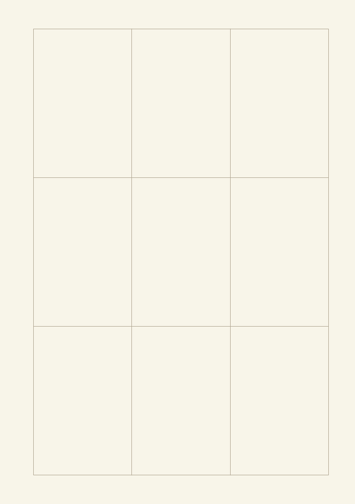
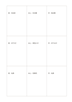

# 三乘三比較矩陣

`matrix-3x3` · `matrix` · `a5-draft`

[繁體中文](README.zh-TW.md) · [English](README.en.md) · [日本語](README.ja.md) · [返回目錄](../../docs/zh-TW/catalog.md)

用九個等大連續儲存格，交叉記錄三個方案與三項條件；沒有九宮格的中心向外發想語意。

## 適合情境

**幾何對照:** `independent` · [mandala-3x3](../mandala-3x3/README.zh-TW.md)

- 比較三種場地的設備、交通與費用。
- 核對三份來源對三個相同問題的回答。

## 使用步驟

1. 先在紙邊自訂三欄方案與三行條件。
2. 每格只填對應交叉項的短證據，缺資料就保留空白。
3. 逐行逐欄比較，另外記錄證據來源與單位。

## 整理後可得到

看見兩個以上維度交叉處的資料缺口與取捨。

## 實際填寫示例

虛構的圖書館、社區中心、戶外亭分別在設備、交通與費用三行留下待核對的短記。

[SVG](examples/zh-TW.svg)

## 不適合情境

九格不會自動表示中心主題；精確評分需另列單位與權重。

## 下載

- [無字 SVG](exports/a5-draft/blank.svg)
- [無字 PDF](exports/a5-draft/blank.pdf)
- [左上角英文名稱 PDF](exports/a5-draft/titled.pdf)
- [深色墨線無字 PDF](exports/a5-contrast/blank.pdf)
- [深色墨線 SVG](exports/a5-contrast/blank.svg)

英文名稱只印在標題版 PDF；無字版仍適合自由列印與改作。

頁面尺寸：A5（148 × 210 mm）；設定檔：`a5-draft`。

## 來源與狀態

既有方法的版面改編 · 詳細來源紀錄見 [manifest.json](manifest.json)  
[MIT 授權範圍](../../LICENSE-SCOPE.md)

[三語術語表](../../docs/zh-TW/glossary.md)

## 修改與重新生成

調整 `src/noteformats/variants.py` 的幾何或 `src/noteformats/variant_content.py` 的文字，再於專案根目錄執行：

`python scripts/build.py --ids matrix-3x3`
