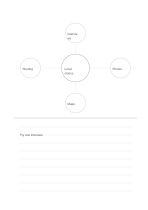

# Concept map with ruled notes

`mindmap-and-ruled` · `hybrid` · `a5-draft`

[繁體中文](README.zh-TW.md) · [English](README.en.md) · [日本語](README.ja.md) · [Back to catalog](../../docs/en/catalog.md)

Explore four directions above, then explain one in readable prose below.

## When to use it

- Find four angles in a reading before writing a summary.
- Brainstorm an event and then describe a pilot approach.

## How to use it

1. Put the topic in the center and distinct angles in the four circles.
2. Choose one angle and explain it concretely on the lower lines.
3. Check whether the prose goes beyond the original map's assumptions.

## What the page helps you see

A drawing, short notes, and a conclusion kept separate but connected.

## Worked example

A fictional local-history talk maps interviews, photos, maps, and sharing, then describes one trial interview below.

[SVG](examples/en.svg)

## When not to use it

Small circles fit short terms; use a full concept map when many branches matter.

## Downloads

- [Wordless SVG](exports/a5-draft/blank.svg)
- [Wordless PDF](exports/a5-draft/blank.pdf)
- [PDF with English name at top left](exports/a5-draft/titled.pdf)
- [Darker-ink wordless PDF](exports/a5-contrast/blank.pdf)
- [Darker-ink SVG](exports/a5-contrast/blank.svg)

The English name appears only on the titled PDF; the wordless version remains available for free writing.

Page size: A5 (148 × 210 mm); profile: `a5-draft`.

## Provenance and status

Original layout · Detailed source record: [manifest.json](manifest.json)  
[MIT license scope](../../LICENSE-SCOPE.md)

[Trilingual glossary](../../docs/en/glossary.md)

## Modify and rebuild

Change `profiles/a5-draft.json` or the corresponding builder in `src/noteformats/layouts/`, then run from the project root:

`python scripts/build.py --ids mindmap-and-ruled`
