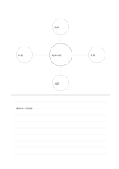

# 概念図と横罫メモ

`mindmap-and-ruled` · `hybrid` · `a5-draft`

[繁體中文](README.zh-TW.md) · [English](README.en.md) · [日本語](README.ja.md) · [一覧へ戻る](../../docs/ja/catalog.md)

上で四方向を広げ、下で一方向を文章にします。

## 向いている場面

- 読書の主題を四観点で整理して要約するとき。
- 催しを発想した後で試行案を書くとき。

## 使い方

1. 上の中心に題材、周囲に異なる四観点を書きます。
2. 一つ選び、下の罫線に具体的な説明を書きます。
3. 文章が図の仮定を越えていないか確かめます。

## 記入後に見えること

図、短い記録、結論を分けながら関係づけられます。

## 記入例

架空の地域の話を面談、写真、地図、共有に分け、下に面談の試行方法を書きます。

[SVG](examples/ja.svg)

## 向いていない場面

小円は短語向けです。枝が多い場合は全頁の概念図を使います。

## ダウンロード

- [文字なしSVG](exports/a5-draft/blank.svg)
- [文字なしPDF](exports/a5-draft/blank.pdf)
- [左上に英語名があるPDF](exports/a5-draft/titled.pdf)
- [濃い線の文字なしPDF](exports/a5-contrast/blank.pdf)
- [濃い線のSVG](exports/a5-contrast/blank.svg)

英語名は表題付きPDFだけに印刷され、文字なし版は自由な記入に使えます。

用紙サイズ：A5（148 × 210 mm）。設定ファイル：`a5-draft`。

## 由来と状態

本プロジェクトの独自レイアウト · 詳しい由来の記録： [manifest.json](manifest.json)  
[MITライセンスの範囲](../../LICENSE-SCOPE.md)

[三言語の用語集](../../docs/ja/glossary.md)

## 変更と再生成

`profiles/a5-draft.json` または `src/noteformats/layouts/` の描画関数を変更し、プロジェクトのルートで実行します：

`python scripts/build.py --ids mindmap-and-ruled`
