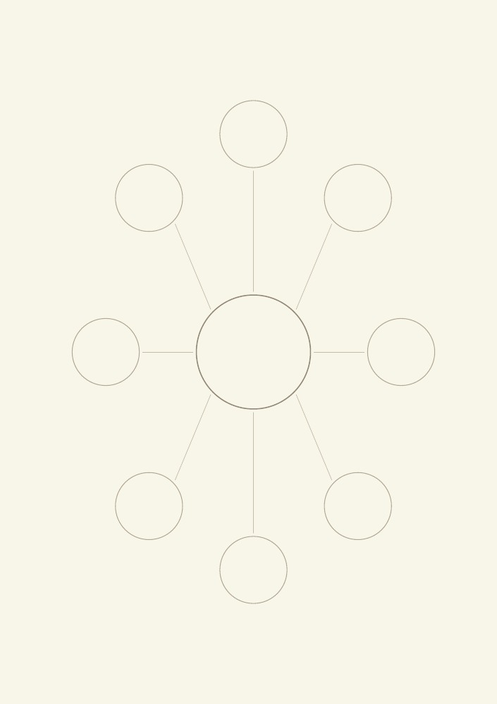
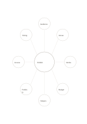

# Eight-branch mind map

`mindmap-eight` · `concept-network` · `a5-draft`

[繁體中文](README.zh-TW.md) · [English](README.en.md) · [日本語](README.ja.md) · [Back to catalog](../../docs/en/catalog.md)

Connect a central topic to eight distinct branches and mark where subtopics are needed. Geometry change: mind-map spokes: 8.

## When to use it

**Geometry relationship:** `parameter` · [mindmap-six](../mindmap-six/README.en.md)

- Plan an exhibition across eight main branches, such as audience, space and content.
- Identify eight main concepts after a long article and add supporting details along their branches.

## How to use it

1. Place the topic in the center, one main concept on each spoke and supporting ideas farther out.
2. Use the worked example to place entries in region order: 1: "Exhibit"; 2: "Audience"; 3: "Venue"; 4: "Works"; 5: "Budget"; 6: "Helpers"; 7: "Publicity"; 8: "Access"; 9: "Timing"
3. Review the regions, mark open questions and choose a next step.

## What the page helps you see

A map of topics, branches, and relationships still to verify.

## Worked example

Entries in example-position order; each number identifies one entry:

1. Exhibit
2. Audience
3. Venue
4. Works
5. Budget
6. Helpers
7. Publicity
8. Access
9. Timing

[SVG](examples/en.svg)

## When not to use it

Outer circles hold short phrases; use a tree or columns for layered reasoning or long notes. Small cells hold short phrases rather than long paragraphs.

## Downloads

- [Wordless SVG](exports/a5-draft/blank.svg)
- [Wordless PDF](exports/a5-draft/blank.pdf)
- [PDF with English name at top left](exports/a5-draft/titled.pdf)
- [Darker-ink wordless PDF](exports/a5-contrast/blank.pdf)
- [Darker-ink SVG](exports/a5-contrast/blank.svg)

The English name appears only on the titled PDF; the wordless version remains available for free writing.

Page size: A5 (148 × 210 mm); profile: `a5-draft`.

## Provenance and status

Common geometry · Detailed source record: [manifest.json](manifest.json)  
[MIT license scope](../../LICENSE-SCOPE.md)

[Trilingual glossary](../../docs/en/glossary.md)

## Modify and rebuild

Edit geometry in `src/noteformats/variants.py` or text in `src/noteformats/variant_content.py`, then run from the project root:

`python scripts/build.py --ids mindmap-eight`
