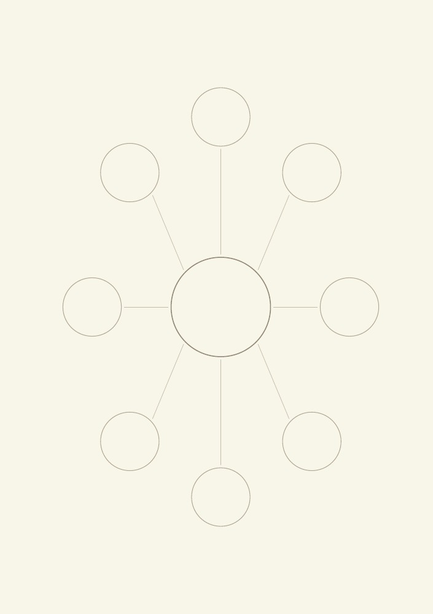
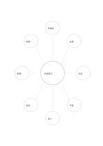

# 八枝のマインドマップ

`mindmap-eight` · `concept-network` · `a5-draft`

[繁體中文](README.zh-TW.md) · [English](README.en.md) · [日本語](README.ja.md) · [一覧へ戻る](../../docs/ja/catalog.md)

中心から八つの異なる枝を広げ、下位の話題が必要な枝を見つけます。 図形の変更： マップの枝数: 8.

## 向いている場面

**図形の対応:** `parameter` · [mindmap-six](../mindmap-six/README.ja.md)

- 展示を中心に、観客・会場・内容など八つの準備面を主枝へ割り当てるとき。
- 長い記事から八つの主要概念を選び、枝に補足の細部を加えるとき。

## 使い方

1. 中心に主題、各枝に主要概念、その先に補足の概念を置きます。
2. 記入例を参考に、領域の順で記します：1「地域展示」；2「来場者」；3「会場」；4「作品」；5「予算」；6「協力」；7「周知」；8「動線」；9「時間」
3. 各領域を読み返し、未確認の点と次の行動を記します。

## 記入後に見えること

主題と枝、確かめ直す関係を一覧できます。

## 記入例

図の記入位置の順に示します。番号一つが一つの記入例です：

1. 地域展示
2. 来場者
3. 会場
4. 作品
5. 予算
6. 協力
7. 周知
8. 動線
9. 時間

[SVG](examples/ja.svg)

## 向いていない場面

外側は短い語句向けです。段階的な推論や長文には樹形図や欄を使ってください。 小さなマスは短い語句向けで、長い文章には向きません。

## ダウンロード

- [文字なしSVG](exports/a5-draft/blank.svg)
- [文字なしPDF](exports/a5-draft/blank.pdf)
- [左上に英語名があるPDF](exports/a5-draft/titled.pdf)
- [濃い線の文字なしPDF](exports/a5-contrast/blank.pdf)
- [濃い線のSVG](exports/a5-contrast/blank.svg)

英語名は表題付きPDFだけに印刷され、文字なし版は自由な記入に使えます。

用紙サイズ：A5（148 × 210 mm）。設定ファイル：`a5-draft`。

## 由来と状態

一般的な幾何構造 · 詳しい由来の記録： [manifest.json](manifest.json)  
[MITライセンスの範囲](../../LICENSE-SCOPE.md)

[三言語の用語集](../../docs/ja/glossary.md)

## 変更と再生成

図形は `src/noteformats/variants.py`、文章は `src/noteformats/variant_content.py` を変更し、プロジェクトのルートで実行します：

`python scripts/build.py --ids mindmap-eight`
