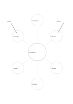

# Six-branch concept map

`mindmap-six` · `concept-network` · `a5-draft`

[繁體中文](README.zh-TW.md) · [English](README.en.md) · [日本語](README.ja.md) · [Back to catalog](../../docs/en/catalog.md)

Expand one central topic into six distinct angles to see the breadth of an idea.

## When to use it

- Gather audiences, space, and materials for a small exhibition.
- Separate six key concepts after reading a chapter.

## How to use it

1. Write one precise topic in the center.
2. Give each outer circle a different angle rather than a synonym.
3. Mark the angle that needs depth and continue on a blank page.

## What the page helps you see

A map of topics, branches, and relationships still to verify.

## Worked example

A fictional neighborhood exhibition branches into audience, venue, works, budget, volunteers, and publicity; venue constraints are checked next.

[SVG](examples/en.svg)

## When not to use it

Outer circles hold short phrases; use a tree or columns for layered reasoning or long notes.

## Downloads

- [Wordless SVG](exports/a5-draft/blank.svg)
- [Wordless PDF](exports/a5-draft/blank.pdf)
- [PDF with English name at top left](exports/a5-draft/titled.pdf)
- [Darker-ink wordless PDF](exports/a5-contrast/blank.pdf)
- [Darker-ink SVG](exports/a5-contrast/blank.svg)

The English name appears only on the titled PDF; the wordless version remains available for free writing.

Page size: A5 (148 × 210 mm); profile: `a5-draft`.

## Provenance and status

Common geometry · Detailed source record: [manifest.json](manifest.json)  
[MIT license scope](../../LICENSE-SCOPE.md)

[Trilingual glossary](../../docs/en/glossary.md)

## Modify and rebuild

Change `profiles/a5-draft.json` or the corresponding builder in `src/noteformats/layouts/`, then run from the project root:

`python scripts/build.py --ids mindmap-six`
