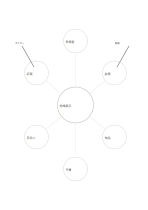

# 六方向のコンセプトマップ

`mindmap-six` · `concept-network` · `a5-draft`

[繁體中文](README.zh-TW.md) · [English](README.en.md) · [日本語](README.ja.md) · [一覧へ戻る](../../docs/ja/catalog.md)

中心のテーマから六つの異なる観点を広げ、考えの幅を見ます。

## 向いている場面

- 小さな展示会について来場者、会場、材料などを集めるとき。
- 章を読んで六つの主要概念を先に分けて書くとき。

## 使い方

1. 中心には具体的なテーマを一つ書きます。
2. 外側の円には同義語を重ねず、別々の観点を書きます。
3. 深掘りしたい観点を選び、詳細は別の紙に続けます。

## 記入後に見えること

主題と枝、確かめ直す関係を一覧できます。

## 記入例

架空の地域展示を中心に、来場者、会場、作品、予算、手伝い、広報を置き、次に会場の制約を調べます。

[SVG](examples/ja.svg)

## 向いていない場面

外側は短い語句向けです。段階的な推論や長文には樹形図や欄を使ってください。

## ダウンロード

- [文字なしSVG](exports/a5-draft/blank.svg)
- [文字なしPDF](exports/a5-draft/blank.pdf)
- [左上に英語名があるPDF](exports/a5-draft/titled.pdf)
- [濃い線の文字なしPDF](exports/a5-contrast/blank.pdf)
- [濃い線のSVG](exports/a5-contrast/blank.svg)

英語名は表題付きPDFだけに印刷され、文字なし版は自由な記入に使えます。

用紙サイズ：A5（148 × 210 mm）。設定ファイル：`a5-draft`。

## 由来と状態

一般的な幾何構造 · 詳しい由来の記録： [manifest.json](manifest.json)  
[MITライセンスの範囲](../../LICENSE-SCOPE.md)

[三言語の用語集](../../docs/ja/glossary.md)

## 変更と再生成

`profiles/a5-draft.json` または `src/noteformats/layouts/` の描画関数を変更し、プロジェクトのルートで実行します：

`python scripts/build.py --ids mindmap-six`
