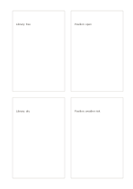

# Paired comparison cards

`mirrored-compare-cards` · `comparison` · `a5-draft`

[繁體中文](README.zh-TW.md) · [English](README.en.md) · [日本語](README.ja.md) · [Back to catalog](../../docs/en/catalog.md)

Pair four cards to compare two venues.

## When to use it

**Geometry relationship:** `equivalent` · [four-cards](../four-cards/README.en.md)

- Compare two venues on cost and rain shelter using matching questions on the left and right cards.
- Arrange the strengths and limits of two objects in four corresponding comparison cards.

## How to use it

1. Pair four cards to compare two venues.
2. Add related phrases or a small sketch inside without forcing row alignment.
3. Review the order and check whether any cards should be combined.

## What the page helps you see

Options compared against shared criteria rather than one impression.

## Worked example

Entries in example-position order; each number identifies one entry:

1. Library: free
2. Pavilion: open
3. Library: dry
4. Pavilion: weather risk

[SVG](examples/en.svg)

## When not to use it

Paired cards are comparable only when their questions, units and evidence scope match; the four card areas are not weights or scores.

## Downloads

- [Wordless SVG](exports/a5-draft/blank.svg)
- [Wordless PDF](exports/a5-draft/blank.pdf)
- [PDF with English name at top left](exports/a5-draft/titled.pdf)
- [Darker-ink wordless PDF](exports/a5-contrast/blank.pdf)
- [Darker-ink SVG](exports/a5-contrast/blank.svg)

The English name appears only on the titled PDF; the wordless version remains available for free writing.

Page size: A5 (148 × 210 mm); profile: `a5-draft`.

## Provenance and status

Generic geometry · Detailed source record: [manifest.json](manifest.json)  
[MIT license scope](../../LICENSE-SCOPE.md)

[Trilingual glossary](../../docs/en/glossary.md)

## Modify and rebuild

Edit geometry in `src/noteformats/variants.py` or text in `src/noteformats/variant_content.py`, then run from the project root:

`python scripts/build.py --ids mirrored-compare-cards`
