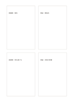

# 対になる比較カード

`mirrored-compare-cards` · `comparison` · `a5-draft`

[繁體中文](README.zh-TW.md) · [English](README.en.md) · [日本語](README.ja.md) · [一覧へ戻る](../../docs/ja/catalog.md)

四枚のカードで二会場を対にして比べます。

## 向いている場面

**図形の対応:** `equivalent` · [four-cards](../four-cards/README.ja.md)

- 二つの会場の費用と雨への対応を、左右で同じ問いのカードに記すとき。
- 二つの物の長所と制約を、左右で対応する四枚のカードに分けるとき。

## 使い方

1. 四枚のカードで二会場を対にして比べます。
2. 関連する語句や小さな図を枠内に加え、無理に行をそろえません。
3. 読む順序を見直し、まとめた方がよい枠がないか確かめます。

## 記入後に見えること

同じ条件で選択肢を見比べ、一つの印象だけで決めることを避けられます。

## 記入例

図の記入位置の順に示します。番号一つが一つの記入例です：

1. 図書館：無料
2. 東屋：開放的
3. 図書館：雨を避ける
4. 東屋：天候の影響

[SVG](examples/ja.svg)

## 向いていない場面

左右のカードは問い・単位・資料の範囲がそろって初めて比較できます。四枚の面積は重みや点数を表しません。

## ダウンロード

- [文字なしSVG](exports/a5-draft/blank.svg)
- [文字なしPDF](exports/a5-draft/blank.pdf)
- [左上に英語名があるPDF](exports/a5-draft/titled.pdf)
- [濃い線の文字なしPDF](exports/a5-contrast/blank.pdf)
- [濃い線のSVG](exports/a5-contrast/blank.svg)

英語名は表題付きPDFだけに印刷され、文字なし版は自由な記入に使えます。

用紙サイズ：A5（148 × 210 mm）。設定ファイル：`a5-draft`。

## 由来と状態

一般的な幾何構造 · 詳しい由来の記録： [manifest.json](manifest.json)  
[MITライセンスの範囲](../../LICENSE-SCOPE.md)

[三言語の用語集](../../docs/ja/glossary.md)

## 変更と再生成

図形は `src/noteformats/variants.py`、文章は `src/noteformats/variant_content.py` を変更し、プロジェクトのルートで実行します：

`python scripts/build.py --ids mirrored-compare-cards`
