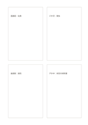

# 成對比較卡

`mirrored-compare-cards` · `comparison` · `a5-draft`

[繁體中文](README.zh-TW.md) · [English](README.en.md) · [日本語](README.ja.md) · [返回目錄](../../docs/zh-TW/catalog.md)

以四張卡成對比較兩個場地。

## 適合情境

**幾何對照:** `equivalent` · [four-cards](../four-cards/README.zh-TW.md)

- 比較兩個場地的費用與避雨條件，讓左右卡使用同一對問題。
- 把兩種物件的優點與限制分成左右對應的四張卡。

## 使用步驟

1. 以四張卡成對比較兩個場地。
2. 在卡內放相關短句或小圖，不必強行逐列對齊。
3. 完成後移動閱讀順序，檢查是否有內容應合併。

## 整理後可得到

用同一組條件逐一比較選項，避免只憑單一印象。

## 實際填寫示例

依圖中填寫位置順序列出，每個編號是一筆示例條目：

1. 圖書館：免費
2. 戶外亭：開放
3. 圖書館：避雨
4. 戶外亭：易受天候影響

[SVG](examples/zh-TW.svg)

## 不適合情境

左右對應卡只有在使用相同問題、單位與資料範圍時才便於比較；四張卡的面積不能當成權重或分數。

## 下載

- [無字 SVG](exports/a5-draft/blank.svg)
- [無字 PDF](exports/a5-draft/blank.pdf)
- [左上角英文名稱 PDF](exports/a5-draft/titled.pdf)
- [深色墨線無字 PDF](exports/a5-contrast/blank.pdf)
- [深色墨線 SVG](exports/a5-contrast/blank.svg)

英文名稱只印在標題版 PDF；無字版仍適合自由列印與改作。

頁面尺寸：A5（148 × 210 mm）；設定檔：`a5-draft`。

## 來源與狀態

通用幾何結構 · 詳細來源紀錄見 [manifest.json](manifest.json)  
[MIT 授權範圍](../../LICENSE-SCOPE.md)

[三語術語表](../../docs/zh-TW/glossary.md)

## 修改與重新生成

調整 `src/noteformats/variants.py` 的幾何或 `src/noteformats/variant_content.py` 的文字，再於專案根目錄執行：

`python scripts/build.py --ids mirrored-compare-cards`
