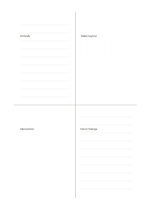

# Mixed-texture quadrants

`mixed-quadrant` · `hybrid` · `a5-draft`

[繁體中文](README.zh-TW.md) · [English](README.en.md) · [日本語](README.ja.md) · [Back to catalog](../../docs/en/catalog.md)

Combine ruled, dotted, and open regions so prose and sketches can share one four-part page.

## When to use it

- Keep event facts, spatial layout, ideas, and next steps together.
- Separate quotation, relationship sketch, questions, and summary while reading.

## How to use it

1. Assign a task to each region yourself; no axis names are preset.
2. Use ruled areas for sentences, dots for position, and the open area for a free sketch.
3. Write a next step and check whether the other regions support it.

## What the page helps you see

A drawing, short notes, and a conclusion kept separate but connected.

## Worked example

A fictional workshop records arrivals, table layout, an interaction sketch, and a process change in the four areas.

[SVG](examples/en.svg)

## When not to use it

Different textures do not guarantee comparable information; use plain quadrants for equal-density regions.

## Downloads

- [Wordless SVG](exports/a5-draft/blank.svg)
- [Wordless PDF](exports/a5-draft/blank.pdf)
- [PDF with English name at top left](exports/a5-draft/titled.pdf)
- [Darker-ink wordless PDF](exports/a5-contrast/blank.pdf)
- [Darker-ink SVG](exports/a5-contrast/blank.svg)

The English name appears only on the titled PDF; the wordless version remains available for free writing.

Page size: A5 (148 × 210 mm); profile: `a5-draft`.

## Provenance and status

Original layout · Detailed source record: [manifest.json](manifest.json)  
[MIT license scope](../../LICENSE-SCOPE.md)

[Trilingual glossary](../../docs/en/glossary.md)

## Modify and rebuild

Change `profiles/a5-draft.json` or the corresponding builder in `src/noteformats/layouts/`, then run from the project root:

`python scripts/build.py --ids mixed-quadrant`
