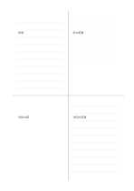

# 異なる罫線の四象限

`mixed-quadrant` · `hybrid` · `a5-draft`

[繁體中文](README.zh-TW.md) · [English](README.en.md) · [日本語](README.ja.md) · [一覧へ戻る](../../docs/ja/catalog.md)

横罫、ドット、余白を四区に混ぜ、文章と草図を同じ紙に置きます。

## 向いている場面

- 催しの事実、配置、考え、次の行動をまとめるとき。
- 読書で引用、関係図、疑問、要約を分けるとき。

## 使い方

1. 四区の役割を自分で決め、固定の軸名にはしません。
2. 横罫には文章、ドットには位置、余白には自由な図を書きます。
3. 最後に次の行動を書き、他の区の内容と合うか確かめます。

## 記入後に見えること

図、短い記録、結論を分けながら関係づけられます。

## 記入例

架空の講座で来場、机の配置、対話の図、次回の変更を四区に分けます。

[SVG](examples/ja.svg)

## 向いていない場面

罫線の違いだけで内容が比較可能になるわけではありません。等量の四区には普通の四象限を使います。

## ダウンロード

- [文字なしSVG](exports/a5-draft/blank.svg)
- [文字なしPDF](exports/a5-draft/blank.pdf)
- [左上に英語名があるPDF](exports/a5-draft/titled.pdf)
- [濃い線の文字なしPDF](exports/a5-contrast/blank.pdf)
- [濃い線のSVG](exports/a5-contrast/blank.svg)

英語名は表題付きPDFだけに印刷され、文字なし版は自由な記入に使えます。

用紙サイズ：A5（148 × 210 mm）。設定ファイル：`a5-draft`。

## 由来と状態

本プロジェクトの独自レイアウト · 詳しい由来の記録： [manifest.json](manifest.json)  
[MITライセンスの範囲](../../LICENSE-SCOPE.md)

[三言語の用語集](../../docs/ja/glossary.md)

## 変更と再生成

`profiles/a5-draft.json` または `src/noteformats/layouts/` の描画関数を変更し、プロジェクトのルートで実行します：

`python scripts/build.py --ids mixed-quadrant`
