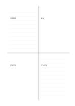

# 混合材質四象限

`mixed-quadrant` · `hybrid` · `a5-draft`

[繁體中文](README.zh-TW.md) · [English](README.en.md) · [日本語](README.ja.md) · [返回目錄](../../docs/zh-TW/catalog.md)

在四區中分別使用橫線、點陣與留白，讓文字與草圖並置。

## 適合情境

- 分析活動時同頁記錄事實、空間配置、想法與下一步。
- 閱讀時把引文、關係草圖、疑問和摘要分開。

## 使用步驟

1. 先自行決定四區的任務，不使用預設軸名。
2. 橫線區寫句子、點陣區畫相對位置、留白區放開放式草圖。
3. 最後橫線區寫下一步，檢查是否由其他三區支持。

## 整理後可得到

把圖、短記與結論放在各自區域，再檢查關係。

## 實際填寫示例

虛構工作坊在左上記到場觀察、右上畫桌位、左下畫互動示意、右下寫下一次要改的流程。

[SVG](examples/zh-TW.svg)

## 不適合情境

不同材質不代表資訊一定可比較；若需四區同樣密度，改用一般四象限。

## 下載

- [無字 SVG](exports/a5-draft/blank.svg)
- [無字 PDF](exports/a5-draft/blank.pdf)
- [左上角英文名稱 PDF](exports/a5-draft/titled.pdf)
- [深色墨線無字 PDF](exports/a5-contrast/blank.pdf)
- [深色墨線 SVG](exports/a5-contrast/blank.svg)

英文名稱只印在標題版 PDF；無字版仍適合自由列印與改作。

頁面尺寸：A5（148 × 210 mm）；設定檔：`a5-draft`。

## 來源與狀態

本專案原創版面 · 詳細來源紀錄見 [manifest.json](manifest.json)  
[MIT 授權範圍](../../LICENSE-SCOPE.md)

[三語術語表](../../docs/zh-TW/glossary.md)

## 修改與重新生成

修改 `profiles/a5-draft.json` 或 `src/noteformats/layouts/` 內對應的繪圖函式，再於專案根目錄執行：

`python scripts/build.py --ids mixed-quadrant`
