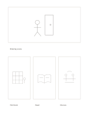

# Mixed-scale four-panel storyboard

`mixed-storyboard` · `storyboard` · `a5-draft`

[繁體中文](README.zh-TW.md) · [English](README.en.md) · [日本語](README.ja.md) · [Back to catalog](../../docs/en/catalog.md)

Establish a scene in one large frame, then show three subsequent beats in smaller frames. Geometry change: One large scene leads to three smaller sequential frames.

## When to use it

**Geometry relationship:** `parameter` · [storyboard-eight-mixed](../storyboard-eight-mixed/README.en.md)

- Establish a venue in the large frame, then use three smaller frames for entry, interaction and departure.
- Pair one main view with three detail shots to plan viewpoint changes in a product introduction.

## How to use it

1. Draw the establishing view in the large frame and three actions or details below.
2. Use the worked example to place entries in region order: 1: "Entering scene"; 2: "Find book"; 3: "Read"; 4: "Discuss"
3. Review the regions, mark open questions and choose a next step.

## What the page helps you see

A visual sequence showing transitions and missing shots.

## Worked example

Entries in example-position order; each number identifies one entry:

1. Entering scene
2. Find book
3. Read
4. Discuss

[SVG](examples/en.svg)

## When not to use it

Small panels cannot carry detail or long prose; production still needs timing, sound, and camera planning. Small cells hold short phrases rather than long paragraphs.

## Downloads

- [Wordless SVG](exports/a5-draft/blank.svg)
- [Wordless PDF](exports/a5-draft/blank.pdf)
- [PDF with English name at top left](exports/a5-draft/titled.pdf)
- [Darker-ink wordless PDF](exports/a5-contrast/blank.pdf)
- [Darker-ink SVG](exports/a5-contrast/blank.svg)

The English name appears only on the titled PDF; the wordless version remains available for free writing.

Page size: A5 (148 × 210 mm); profile: `a5-draft`.

## Provenance and status

Original layout · Detailed source record: [manifest.json](manifest.json)  
[MIT license scope](../../LICENSE-SCOPE.md)

[Trilingual glossary](../../docs/en/glossary.md)

## Modify and rebuild

Edit geometry in `src/noteformats/variants.py` or text in `src/noteformats/variant_content.py`, then run from the project root:

`python scripts/build.py --ids mixed-storyboard`
