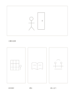

# 大小混合の四コマ絵コンテ

`mixed-storyboard` · `storyboard` · `a5-draft`

[繁體中文](README.zh-TW.md) · [English](README.en.md) · [日本語](README.ja.md) · [一覧へ戻る](../../docs/ja/catalog.md)

大きい一コマで場面を示し、後の三つの動きを小さなコマに描きます。 図形の変更： 大きな一場面の後に小さな三場面を並べました。

## 向いている場面

**図形の対応:** `parameter` · [storyboard-eight-mixed](../storyboard-eight-mixed/README.ja.md)

- 大枠に会場全景を示し、三つの小枠に入場・交流・退出を描くとき。
- 一枚の主要画面と三枚の細部画面で、製品紹介の視点の切替えを考えるとき。

## 使い方

1. 大枠に全景、下の三枠に続く動作や細部を描きます。
2. 記入例を参考に、領域の順で記します：1「入館の全景」；2「本を探す」；3「読む」；4「話し合う」
3. 各領域を読み返し、未確認の点と次の行動を記します。

## 記入後に見えること

連続した場面から変化や足りないカットが見えます。

## 記入例

図の記入位置の順に示します。番号一つが一つの記入例です：

1. 入館の全景
2. 本を探す
3. 読む
4. 話し合う

[SVG](examples/ja.svg)

## 向いていない場面

小コマに細部や長文は入りません。撮影には時間、音、カメラの計画も必要です。 小さなマスは短い語句向けで、長い文章には向きません。

## ダウンロード

- [文字なしSVG](exports/a5-draft/blank.svg)
- [文字なしPDF](exports/a5-draft/blank.pdf)
- [左上に英語名があるPDF](exports/a5-draft/titled.pdf)
- [濃い線の文字なしPDF](exports/a5-contrast/blank.pdf)
- [濃い線のSVG](exports/a5-contrast/blank.svg)

英語名は表題付きPDFだけに印刷され、文字なし版は自由な記入に使えます。

用紙サイズ：A5（148 × 210 mm）。設定ファイル：`a5-draft`。

## 由来と状態

本プロジェクトの独自レイアウト · 詳しい由来の記録： [manifest.json](manifest.json)  
[MITライセンスの範囲](../../LICENSE-SCOPE.md)

[三言語の用語集](../../docs/ja/glossary.md)

## 変更と再生成

図形は `src/noteformats/variants.py`、文章は `src/noteformats/variant_content.py` を変更し、プロジェクトのルートで実行します：

`python scripts/build.py --ids mixed-storyboard`
