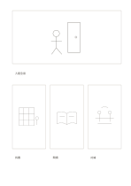

# 大小交錯四格故事板

`mixed-storyboard` · `storyboard` · `a5-draft`

[繁體中文](README.zh-TW.md) · [English](README.en.md) · [日本語](README.ja.md) · [返回目錄](../../docs/zh-TW/catalog.md)

用一個大畫面建立場景，再以三個小畫格展示後續動作。 本款的幾何變化： 一個大畫面接三個較小的連續畫面。

## 適合情境

**幾何對照:** `parameter` · [storyboard-eight-mixed](../storyboard-eight-mixed/README.zh-TW.md)

- 先用大框交代場地全景，再以三個小框畫人物進入、互動與離開。
- 用一張主要畫面配三張局部畫面，檢查產品介紹片的視角切換。

## 使用步驟

1. 大框畫背景全景，下方三小框畫接續的動作或細節。
2. 參考本頁示例，各區依序記錄：1「入館全景」；2「找書」；3「閱讀」；4「討論」
3. 回看各區，標記仍待查證的內容，再決定下一步。

## 整理後可得到

從連續畫面看出事件轉折與仍缺的鏡頭。

## 實際填寫示例

依圖中填寫位置順序列出，每個編號是一筆示例條目：

1. 入館全景
2. 找書
3. 閱讀
4. 討論

[SVG](examples/zh-TW.svg)

## 不適合情境

小格不適合細節或長句；正式拍攝還需鏡頭、時間與聲音規劃。 細小格子只宜短語，不適合長篇段落。

## 下載

- [無字 SVG](exports/a5-draft/blank.svg)
- [無字 PDF](exports/a5-draft/blank.pdf)
- [左上角英文名稱 PDF](exports/a5-draft/titled.pdf)
- [深色墨線無字 PDF](exports/a5-contrast/blank.pdf)
- [深色墨線 SVG](exports/a5-contrast/blank.svg)

英文名稱只印在標題版 PDF；無字版仍適合自由列印與改作。

頁面尺寸：A5（148 × 210 mm）；設定檔：`a5-draft`。

## 來源與狀態

本專案原創版面 · 詳細來源紀錄見 [manifest.json](manifest.json)  
[MIT 授權範圍](../../LICENSE-SCOPE.md)

[三語術語表](../../docs/zh-TW/glossary.md)

## 修改與重新生成

調整 `src/noteformats/variants.py` 的幾何或 `src/noteformats/variant_content.py` 的文字，再於專案根目錄執行：

`python scripts/build.py --ids mixed-storyboard`
