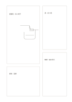

# 不等幅のモザイクカード

`mosaic-cards` · `cards` · `a5-draft`

[繁體中文](README.zh-TW.md) · [English](README.en.md) · [日本語](README.ja.md) · [一覧へ戻る](../../docs/ja/catalog.md)

大きさの異なる四枠で主内容、補足情報、短い注記を分けます。

## 向いている場面

- 物の大きな図と仕様、材料、疑問を一枚に置くとき。
- 文章の主張と三種類の注記を並べるとき。

## 使い方

1. 最も場所が必要な内容を左上の大きな枠に置きます。
2. 残る三枠に異なる補足を入れ、同じ長さにそろえる必要はありません。
3. 主な枠から順に注記を見直し、関係のないものを外します。

## 記入後に見えること

項目を分けて、並べ替えや比較、選択ができます。

## 記入例

架空の読書コーナーの図を主枠に、照明、席、未検証の動線を他の枠に置きます。

[SVG](examples/ja.svg)

## 向いていない場面

同じ量の話題には不等幅が無駄になり、固定幅の表にも向きません。

## ダウンロード

- [文字なしSVG](exports/a5-draft/blank.svg)
- [文字なしPDF](exports/a5-draft/blank.pdf)
- [左上に英語名があるPDF](exports/a5-draft/titled.pdf)
- [濃い線の文字なしPDF](exports/a5-contrast/blank.pdf)
- [濃い線のSVG](exports/a5-contrast/blank.svg)

英語名は表題付きPDFだけに印刷され、文字なし版は自由な記入に使えます。

用紙サイズ：A5（148 × 210 mm）。設定ファイル：`a5-draft`。

## 由来と状態

本プロジェクトの独自レイアウト · 詳しい由来の記録： [manifest.json](manifest.json)  
[MITライセンスの範囲](../../LICENSE-SCOPE.md)

[三言語の用語集](../../docs/ja/glossary.md)

## 変更と再生成

`profiles/a5-draft.json` または `src/noteformats/layouts/` の描画関数を変更し、プロジェクトのルートで実行します：

`python scripts/build.py --ids mosaic-cards`
