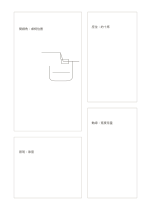

# 不等比分格卡

`mosaic-cards` · `cards` · `a5-draft`

[繁體中文](README.zh-TW.md) · [English](README.en.md) · [日本語](README.ja.md) · [返回目錄](../../docs/zh-TW/catalog.md)

用大小不同的四張卡區分主內容、補充資料與短註。

## 適合情境

- 記錄一個物件的大圖、規格、材料與問題。
- 把一篇文章的核心論點與三類旁註排在同頁。

## 使用步驟

1. 把需要最多空間的內容放左上大卡。
2. 其餘三卡分別放補充資料，不必強求同長。
3. 從大卡出發逐張檢查旁註是否仍有關聯。

## 整理後可得到

把可移動的事項分開，方便排序、比較或選擇。

## 實際填寫示例

示例以虛構閱讀角為主圖，其他卡分別記照明、座位和待測的動線。

[SVG](examples/zh-TW.svg)

## 不適合情境

資料量差不多時不等大的區域會浪費空間；也不適合固定欄寬表格。

## 下載

- [無字 SVG](exports/a5-draft/blank.svg)
- [無字 PDF](exports/a5-draft/blank.pdf)
- [左上角英文名稱 PDF](exports/a5-draft/titled.pdf)
- [深色墨線無字 PDF](exports/a5-contrast/blank.pdf)
- [深色墨線 SVG](exports/a5-contrast/blank.svg)

英文名稱只印在標題版 PDF；無字版仍適合自由列印與改作。

頁面尺寸：A5（148 × 210 mm）；設定檔：`a5-draft`。

## 來源與狀態

本專案原創版面 · 詳細來源紀錄見 [manifest.json](manifest.json)  
[MIT 授權範圍](../../LICENSE-SCOPE.md)

[三語術語表](../../docs/zh-TW/glossary.md)

## 修改與重新生成

修改 `profiles/a5-draft.json` 或 `src/noteformats/layouts/` 內對應的繪圖函式，再於專案根目錄執行：

`python scripts/build.py --ids mosaic-cards`
