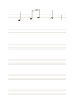

# Blank music staff

`music-staff` · `special-paper` · `a5-draft`

[繁體中文](README.zh-TW.md) · [English](README.en.md) · [日本語](README.ja.md) · [Back to catalog](../../docs/en/catalog.md)

Six five-line staves provide room for handwritten pitch, rhythm, and short melody drafts.

## When to use it

- Jot down a melody you invented.
- Practice placing known notes on staff positions.

## How to use it

1. Add your own clef and any needed time signature at the left.
2. Place notes on lines or spaces and add barlines if useful.
3. Sing or play the phrase back and check pitch and rhythm.

## What the page helps you see

Notation, letterforms, or sketches aligned to the specialized guides.

## Worked example

The first staff shows editable vector notation: a quarter note, two beamed eighth notes, a half note, and a barline. Without a clef, the example does not claim note names.

[SVG](examples/en.svg)

## When not to use it

No clef, key, or time signature is printed; beginners need a reliable reference. Fine-line print clarity remains untested.

## Downloads

- [Wordless SVG](exports/a5-draft/blank.svg)
- [Wordless PDF](exports/a5-draft/blank.pdf)
- [PDF with English name at top left](exports/a5-draft/titled.pdf)
- [Darker-ink wordless PDF](exports/a5-contrast/blank.pdf)
- [Darker-ink SVG](exports/a5-contrast/blank.svg)

The English name appears only on the titled PDF; the wordless version remains available for free writing.

Page size: A5 (148 × 210 mm); profile: `a5-draft`.

## Provenance and status

Common geometry · Detailed source record: [manifest.json](manifest.json)  
[MIT license scope](../../LICENSE-SCOPE.md)

[Trilingual glossary](../../docs/en/glossary.md)

## Modify and rebuild

Change `profiles/a5-draft.json` or the corresponding builder in `src/noteformats/layouts/`, then run from the project root:

`python scripts/build.py --ids music-staff`
