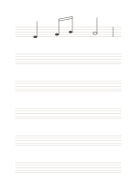

# 空白の五線譜

`music-staff` · `special-paper` · `a5-draft`

[繁體中文](README.zh-TW.md) · [English](README.en.md) · [日本語](README.ja.md) · [一覧へ戻る](../../docs/ja/catalog.md)

六段の五線に、音高、リズム、短い旋律を手書きできます。

## 向いている場面

- 思いついた旋律を控えるとき。
- 既知の音を五線上に置く練習をするとき。

## 使い方

1. 各段の左に音部記号と必要な拍子を書きます。
2. 線と間に音符を置き、必要なら小節線を足します。
3. 歌うか演奏して、音高とリズムを確かめます。

## 記入後に見えること

専用の罫線に沿った記譜、文字、下書きを確認できます。

## 記入例

最初の段に編集可能なベクターの四分音符、連桿で結んだ二つの八分音符、二分音符と小節線を示します。音部記号がないため、音名は断定しません。

[SVG](examples/ja.svg)

## 向いていない場面

音部記号、調号、拍子は印刷されていません。初学者は信頼できる教材で確認してください。細線の印刷品質は未試験です。

## ダウンロード

- [文字なしSVG](exports/a5-draft/blank.svg)
- [文字なしPDF](exports/a5-draft/blank.pdf)
- [左上に英語名があるPDF](exports/a5-draft/titled.pdf)
- [濃い線の文字なしPDF](exports/a5-contrast/blank.pdf)
- [濃い線のSVG](exports/a5-contrast/blank.svg)

英語名は表題付きPDFだけに印刷され、文字なし版は自由な記入に使えます。

用紙サイズ：A5（148 × 210 mm）。設定ファイル：`a5-draft`。

## 由来と状態

一般的な幾何構造 · 詳しい由来の記録： [manifest.json](manifest.json)  
[MITライセンスの範囲](../../LICENSE-SCOPE.md)

[三言語の用語集](../../docs/ja/glossary.md)

## 変更と再生成

`profiles/a5-draft.json` または `src/noteformats/layouts/` の描画関数を変更し、プロジェクトのルートで実行します：

`python scripts/build.py --ids music-staff`
