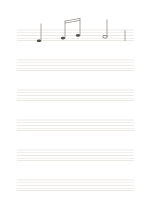

# 空白五線譜

`music-staff` · `special-paper` · `a5-draft`

[繁體中文](README.zh-TW.md) · [English](README.en.md) · [日本語](README.ja.md) · [返回目錄](../../docs/zh-TW/catalog.md)

提供六組五線譜，供手寫音高、節奏與短樂句草稿。

## 適合情境

- 記一段自己想出的旋律。
- 練習把已知音符位置寫到譜線上。

## 使用步驟

1. 在每組左端自行寫譜號與需要的拍號。
2. 按音高把音符寫在線上或線間，必要時加小節線。
3. 回頭唱或彈一次，核對節奏與位置。

## 整理後可得到

依專用線格留下可檢查的記譜、練字或草圖。

## 實際填寫示例

示例第一組畫出可編輯向量音符：四分音符、兩個連桿八分音符、二分音符與小節線。未標譜號，所以不指定音名；請依實際譜號核對音高。

[SVG](examples/zh-TW.svg)

## 不適合情境

此頁不預印譜號、調號或拍號；初學者需另用可靠教材核對規則。未試印前不保證細線在所有印表機清晰。

## 下載

- [無字 SVG](exports/a5-draft/blank.svg)
- [無字 PDF](exports/a5-draft/blank.pdf)
- [左上角英文名稱 PDF](exports/a5-draft/titled.pdf)
- [深色墨線無字 PDF](exports/a5-contrast/blank.pdf)
- [深色墨線 SVG](exports/a5-contrast/blank.svg)

英文名稱只印在標題版 PDF；無字版仍適合自由列印與改作。

頁面尺寸：A5（148 × 210 mm）；設定檔：`a5-draft`。

## 來源與狀態

通用幾何結構 · 詳細來源紀錄見 [manifest.json](manifest.json)  
[MIT 授權範圍](../../LICENSE-SCOPE.md)

[三語術語表](../../docs/zh-TW/glossary.md)

## 修改與重新生成

修改 `profiles/a5-draft.json` 或 `src/noteformats/layouts/` 內對應的繪圖函式，再於專案根目錄執行：

`python scripts/build.py --ids music-staff`
