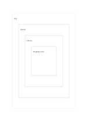

# Nested scope rectangles

`nested-rectangles` · `hierarchy` · `a5-draft`

[繁體中文](README.zh-TW.md) · [English](README.en.md) · [日本語](README.ja.md) · [Back to catalog](../../docs/en/catalog.md)

Use four containing regions to narrow a topic from broad context to a specific object.

## When to use it

- Focus from city to neighborhood, venue, and one room.
- Narrow a research area into a single question.

## How to use it

1. Name the broadest scope on the outer band.
2. Narrow by one meaningful level at each inner band.
3. Put the actual object in the center and check that the boundaries are clear.

## What the page helps you see

Levels of a goal or topic, with gaps easier to notice.

## Worked example

A fictional event narrows from city to neighborhood to library to reading room, making the venue discussion specific.

[SVG](examples/en.svg)

## When not to use it

Containment does not show peers or time order; use another format for those relations.

## Downloads

- [Wordless SVG](exports/a5-draft/blank.svg)
- [Wordless PDF](exports/a5-draft/blank.pdf)
- [PDF with English name at top left](exports/a5-draft/titled.pdf)
- [Darker-ink wordless PDF](exports/a5-contrast/blank.pdf)
- [Darker-ink SVG](exports/a5-contrast/blank.svg)

The English name appears only on the titled PDF; the wordless version remains available for free writing.

Page size: A5 (148 × 210 mm); profile: `a5-draft`.

## Provenance and status

Common geometry · Detailed source record: [manifest.json](manifest.json)  
[MIT license scope](../../LICENSE-SCOPE.md)

[Trilingual glossary](../../docs/en/glossary.md)

## Modify and rebuild

Change `profiles/a5-draft.json` or the corresponding builder in `src/noteformats/layouts/`, then run from the project root:

`python scripts/build.py --ids nested-rectangles`
