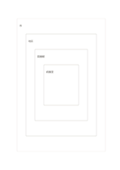

# 入れ子の範囲図

`nested-rectangles` · `hierarchy` · `a5-draft`

[繁體中文](README.zh-TW.md) · [English](README.en.md) · [日本語](README.ja.md) · [一覧へ戻る](../../docs/ja/catalog.md)

四つの包含する領域で、大きな文脈から具体的な対象へ絞ります。

## 向いている場面

- 市、地区、施設、一室へと場所を特定するとき。
- 研究分野から一つの問いへ焦点を狭めるとき。

## 使い方

1. 一番外側に最も広い範囲を書きます。
2. 内側へ一段ずつ意味のある範囲に狭めます。
3. 中心に扱う対象を置き、境界が明確か確かめます。

## 記入後に見えること

目的や話題の階層と、抜けている要素が見えます。

## 記入例

架空の催しの場所を市、地区、図書館、読書室へと狭め、会場の話を具体化します。

[SVG](examples/ja.svg)

## 向いていない場面

包含だけを示す図です。並列の分類や時間順序は表せません。

## ダウンロード

- [文字なしSVG](exports/a5-draft/blank.svg)
- [文字なしPDF](exports/a5-draft/blank.pdf)
- [左上に英語名があるPDF](exports/a5-draft/titled.pdf)
- [濃い線の文字なしPDF](exports/a5-contrast/blank.pdf)
- [濃い線のSVG](exports/a5-contrast/blank.svg)

英語名は表題付きPDFだけに印刷され、文字なし版は自由な記入に使えます。

用紙サイズ：A5（148 × 210 mm）。設定ファイル：`a5-draft`。

## 由来と状態

一般的な幾何構造 · 詳しい由来の記録： [manifest.json](manifest.json)  
[MITライセンスの範囲](../../LICENSE-SCOPE.md)

[三言語の用語集](../../docs/ja/glossary.md)

## 変更と再生成

`profiles/a5-draft.json` または `src/noteformats/layouts/` の描画関数を変更し、プロジェクトのルートで実行します：

`python scripts/build.py --ids nested-rectangles`
