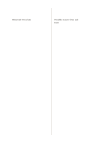

# Observation and interpretation

`observation-interpretation` · `research` · `a5-draft`

[繁體中文](README.zh-TW.md) · [English](README.en.md) · [日本語](README.ja.md) · [Back to catalog](../../docs/en/catalog.md)

Separate direct observation from a tentative interpretation.

## When to use it

**Geometry relationship:** `equivalent` · [two-equal-columns](../two-equal-columns/README.en.md)

- Observe a workshop and separate visible behavior from your guesses about its reasons.
- Inspect how an object is used, placing observed events on the left and possible explanations on the right.

## How to use it

1. Record only specific things seen or heard on the left, leaving causal guesses out.
2. Write possible interpretations on the right and mark their matching observations.
3. Ask what evidence each interpretation still needs and retain alternative explanations.

## What the page helps you see

Sources, quotations, claims, and open checks kept distinct.

## Worked example

Entries in example-position order; each number identifies one entry:

1. Observed: three late
2. Possible reason: time; ask them

[SVG](examples/en.svg)

## When not to use it

Visible behavior does not directly establish another person's motives; the observer's selection and viewpoint also shape the record, so retain alternative explanations and open checks.

## Downloads

- [Wordless SVG](exports/a5-draft/blank.svg)
- [Wordless PDF](exports/a5-draft/blank.pdf)
- [PDF with English name at top left](exports/a5-draft/titled.pdf)
- [Darker-ink wordless PDF](exports/a5-contrast/blank.pdf)
- [Darker-ink SVG](exports/a5-contrast/blank.svg)

The English name appears only on the titled PDF; the wordless version remains available for free writing.

Page size: A5 (148 × 210 mm); profile: `a5-draft`.

## Provenance and status

Generic geometry · Detailed source record: [manifest.json](manifest.json)  
[MIT license scope](../../LICENSE-SCOPE.md)

[Trilingual glossary](../../docs/en/glossary.md)

## Modify and rebuild

Edit geometry in `src/noteformats/variants.py` or text in `src/noteformats/variant_content.py`, then run from the project root:

`python scripts/build.py --ids observation-interpretation`
