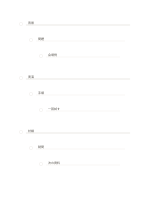

# 字下げ式アウトライン

`outline-notes` · `learning` · `a5-draft`

[繁體中文](README.zh-TW.md) · [English](README.en.md) · [日本語](README.ja.md) · [一覧へ戻る](../../docs/ja/catalog.md)

字下げで主題、下位項目、例の三層を示します。

## 向いている場面

- 講演の三つの部分と細部を整理するとき。
- 短い文章を書く前に段落の骨組みを作るとき。

## 使い方

1. 各組の一行目に主題を書きます。
2. 次の行を一段ずつ下げ、必ず上位項目に属する内容にします。
3. 読み返して層が曖昧なら行を移すか書き直します。

## 記入後に見えること

概念、手がかり、思い出した答えを照合できます。

## 記入例

架空の講演を背景、実演、討論に分け、各段に要点と例を一つずつ置きます。

[SVG](examples/ja.svg)

## 向いていない場面

字下げは時間、因果、重要度を示しません。交差する関係にはネットワーク図が向きます。

## ダウンロード

- [文字なしSVG](exports/a5-draft/blank.svg)
- [文字なしPDF](exports/a5-draft/blank.pdf)
- [左上に英語名があるPDF](exports/a5-draft/titled.pdf)
- [濃い線の文字なしPDF](exports/a5-contrast/blank.pdf)
- [濃い線のSVG](exports/a5-contrast/blank.svg)

英語名は表題付きPDFだけに印刷され、文字なし版は自由な記入に使えます。

用紙サイズ：A5（148 × 210 mm）。設定ファイル：`a5-draft`。

## 由来と状態

一般的な幾何構造 · 詳しい由来の記録： [manifest.json](manifest.json)  
[MITライセンスの範囲](../../LICENSE-SCOPE.md)

[三言語の用語集](../../docs/ja/glossary.md)

## 変更と再生成

`profiles/a5-draft.json` または `src/noteformats/layouts/` の描画関数を変更し、プロジェクトのルートで実行します：

`python scripts/build.py --ids outline-notes`
