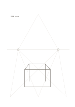

# Two-point perspective guides

`perspective-guides` · `special-paper` · `a5-draft`

[繁體中文](README.zh-TW.md) · [English](README.en.md) · [日本語](README.ja.md) · [Back to catalog](../../docs/en/catalog.md)

Use a horizon and two vanishing points to draft rough two-point perspective.

## When to use it

- Sketch a fictional exhibition corner or table.
- Practice making box edges converge in two directions.

## How to use it

1. Locate the horizon and both vanishing points.
2. Choose a box edge and extend horizontal directions toward the appropriate points.
3. Add vertical edges, erase unused guides, and check the view.

## What the page helps you see

Notation, letterforms, or sketches aligned to the specialized guides.

## Worked example

Original editable vector lines show a fictional display table's top, sides, and front among the pale rays; they indicate direction, not measured size.

[SVG](examples/en.svg)

## When not to use it

Printed guides show one provisional view, not photogrammetry or a measured architectural perspective.

## Downloads

- [Wordless SVG](exports/a5-draft/blank.svg)
- [Wordless PDF](exports/a5-draft/blank.pdf)
- [PDF with English name at top left](exports/a5-draft/titled.pdf)
- [Darker-ink wordless PDF](exports/a5-contrast/blank.pdf)
- [Darker-ink SVG](exports/a5-contrast/blank.svg)

The English name appears only on the titled PDF; the wordless version remains available for free writing.

Page size: A5 (148 × 210 mm); profile: `a5-draft`.

## Provenance and status

Common geometry · Detailed source record: [manifest.json](manifest.json)  
[MIT license scope](../../LICENSE-SCOPE.md)

[Trilingual glossary](../../docs/en/glossary.md)

## Modify and rebuild

Change `profiles/a5-draft.json` or the corresponding builder in `src/noteformats/layouts/`, then run from the project root:

`python scripts/build.py --ids perspective-guides`
