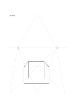

# 二点透視の補助線

`perspective-guides` · `special-paper` · `a5-draft`

[繁體中文](README.zh-TW.md) · [English](README.en.md) · [日本語](README.ja.md) · [一覧へ戻る](../../docs/ja/catalog.md)

地平線と左右の消失点で、二点透視の大まかな草図を描きます。

## 向いている場面

- 架空の展示室の角や机を描くとき。
- 箱の辺を二方向へ収束させる練習をするとき。

## 使い方

1. 地平線と左右の消失点を確認します。
2. 箱の一辺を決め、水平の方向を対応する点へ延ばします。
3. 垂直辺を加え、不要な補助線を消して視点を確認します。

## 記入後に見えること

専用の罫線に沿った記譜、文字、下書きを確認できます。

## 記入例

淡い補助線の間に、架空の展示台の天板、側面、前面を編集可能な独自の線画で示します。実測寸法ではありません。

[SVG](examples/ja.svg)

## 向いていない場面

印刷された線は一つの仮の視点で、写真測量や正確な建築透視図ではありません。

## ダウンロード

- [文字なしSVG](exports/a5-draft/blank.svg)
- [文字なしPDF](exports/a5-draft/blank.pdf)
- [左上に英語名があるPDF](exports/a5-draft/titled.pdf)
- [濃い線の文字なしPDF](exports/a5-contrast/blank.pdf)
- [濃い線のSVG](exports/a5-contrast/blank.svg)

英語名は表題付きPDFだけに印刷され、文字なし版は自由な記入に使えます。

用紙サイズ：A5（148 × 210 mm）。設定ファイル：`a5-draft`。

## 由来と状態

一般的な幾何構造 · 詳しい由来の記録： [manifest.json](manifest.json)  
[MITライセンスの範囲](../../LICENSE-SCOPE.md)

[三言語の用語集](../../docs/ja/glossary.md)

## 変更と再生成

`profiles/a5-draft.json` または `src/noteformats/layouts/` の描画関数を変更し、プロジェクトのルートで実行します：

`python scripts/build.py --ids perspective-guides`
