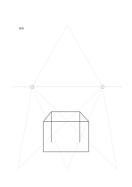

# 兩點透視輔助線

`perspective-guides` · `special-paper` · `a5-draft`

[繁體中文](README.zh-TW.md) · [English](README.en.md) · [日本語](README.ja.md) · [返回目錄](../../docs/zh-TW/catalog.md)

用地平線與左右消失點構思物件的兩點透視草圖。

## 適合情境

- 畫虛構展場的角落與桌面。
- 練習讓方盒的水平邊朝兩個方向收斂。

## 使用步驟

1. 先確認地平線和左右兩個消失點的位置。
2. 以淡線選擇一個盒體邊緣，讓相關水平邊朝消失點延伸。
3. 補上垂直邊，擦除不需要的輔助線並檢查視角。

## 整理後可得到

依專用線格留下可檢查的記譜、練字或草圖。

## 實際填寫示例

示例在淡輔助線間以原創向量線條畫出虛構展桌的桌面、兩側與立面；只示意透視方向，不表示實際尺寸。

[SVG](examples/zh-TW.svg)

## 不適合情境

預印的輔助線只示範一種視角，不是攝影測量或精確建築透視。

## 下載

- [無字 SVG](exports/a5-draft/blank.svg)
- [無字 PDF](exports/a5-draft/blank.pdf)
- [左上角英文名稱 PDF](exports/a5-draft/titled.pdf)
- [深色墨線無字 PDF](exports/a5-contrast/blank.pdf)
- [深色墨線 SVG](exports/a5-contrast/blank.svg)

英文名稱只印在標題版 PDF；無字版仍適合自由列印與改作。

頁面尺寸：A5（148 × 210 mm）；設定檔：`a5-draft`。

## 來源與狀態

通用幾何結構 · 詳細來源紀錄見 [manifest.json](manifest.json)  
[MIT 授權範圍](../../LICENSE-SCOPE.md)

[三語術語表](../../docs/zh-TW/glossary.md)

## 修改與重新生成

修改 `profiles/a5-draft.json` 或 `src/noteformats/layouts/` 內對應的繪圖函式，再於專案根目錄執行：

`python scripts/build.py --ids perspective-guides`
