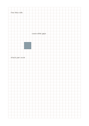

# Pixel and stitch grid

`pixel-stitch-grid` · `special-paper` · `a5-draft`

[繁體中文](README.zh-TW.md) · [English](README.en.md) · [日本語](README.ja.md) · [Back to catalog](../../docs/en/catalog.md)

Plan pixel or stitch color blocks on the grid and note a material question.

## When to use it

**Geometry relationship:** `equivalent` · [grid-standard](../grid-standard/README.en.md)

- Color a simple pixel motif cell by cell, defining one square as one pixel.
- Plan a small knitting or embroidery pattern and count its repeating stitch units.

## How to use it

1. Plan pixel or stitch color blocks on the grid and note a material question.
2. Place lines or short labels on the grid and leave adjacent cells for notes.
3. Check scale assumptions afterward and record real measurements separately.

## What the page helps you see

Notation, letterforms, or sketches aligned to the specialized guides.

## Worked example

Entries in example-position order; each number identifies one entry:

1. Four blue cells
2. Leave white gaps
3. Check yarn count

[SVG](examples/en.svg)

## When not to use it

Paper squares may not match the proportions of real stitches or stretched yarn; cell counts can plan a motif, but finished dimensions and material quantities require separate conversion.

## Downloads

- [Wordless SVG](exports/a5-draft/blank.svg)
- [Wordless PDF](exports/a5-draft/blank.pdf)
- [PDF with English name at top left](exports/a5-draft/titled.pdf)
- [Darker-ink wordless PDF](exports/a5-contrast/blank.pdf)
- [Darker-ink SVG](exports/a5-contrast/blank.svg)

The English name appears only on the titled PDF; the wordless version remains available for free writing.

Page size: A5 (148 × 210 mm); profile: `a5-draft`.

## Provenance and status

Adaptation of traditional writing paper · Detailed source record: [manifest.json](manifest.json)  
[MIT license scope](../../LICENSE-SCOPE.md)

[Trilingual glossary](../../docs/en/glossary.md)

## Modify and rebuild

Edit geometry in `src/noteformats/variants.py` or text in `src/noteformats/variant_content.py`, then run from the project root:

`python scripts/build.py --ids pixel-stitch-grid`
