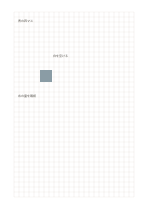

# 画素と編み目の方眼

`pixel-stitch-grid` · `special-paper` · `a5-draft`

[繁體中文](README.zh-TW.md) · [English](README.en.md) · [日本語](README.ja.md) · [一覧へ戻る](../../docs/ja/catalog.md)

マスに画素や編み目の色を置き、材料の確認点も記します。

## 向いている場面

**図形の対応:** `equivalent` · [grid-standard](../grid-standard/README.ja.md)

- 一マスを一画素と決め、簡単なピクセル模様を塗り分けるとき。
- 小さな編み物や刺繍の図案で、繰り返す単位のマス数を数えるとき。

## 使い方

1. マスに画素や編み目の色を置き、材料の確認点も記します。
2. 格子に沿って線や短い語を書き、隣のマスを注記用に残します。
3. あとで縮尺の仮定を確かめ、実測値は別に記します。

## 記入後に見えること

専用の罫線に沿った記譜、文字、下書きを確認できます。

## 記入例

図の記入位置の順に示します。番号一つが一つの記入例です：

1. 青の四マス
2. 白を空ける
3. 糸の量を確認

[SVG](examples/ja.svg)

## 向いていない場面

紙の正方形は実際の編み目や伸びた糸の比率と一致するとは限りません。マス数で模様を考えられますが、仕上がり寸法や材料量は別に換算します。

## ダウンロード

- [文字なしSVG](exports/a5-draft/blank.svg)
- [文字なしPDF](exports/a5-draft/blank.pdf)
- [左上に英語名があるPDF](exports/a5-draft/titled.pdf)
- [濃い線の文字なしPDF](exports/a5-contrast/blank.pdf)
- [濃い線のSVG](exports/a5-contrast/blank.svg)

英語名は表題付きPDFだけに印刷され、文字なし版は自由な記入に使えます。

用紙サイズ：A5（148 × 210 mm）。設定ファイル：`a5-draft`。

## 由来と状態

伝統的な練習紙の応用 · 詳しい由来の記録： [manifest.json](manifest.json)  
[MITライセンスの範囲](../../LICENSE-SCOPE.md)

[三言語の用語集](../../docs/ja/glossary.md)

## 変更と再生成

図形は `src/noteformats/variants.py`、文章は `src/noteformats/variant_content.py` を変更し、プロジェクトのルートで実行します：

`python scripts/build.py --ids pixel-stitch-grid`
