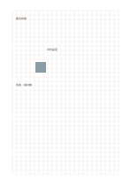

# 像素與針織方格

`pixel-stitch-grid` · `special-paper` · `a5-draft`

[繁體中文](README.zh-TW.md) · [English](README.en.md) · [日本語](README.ja.md) · [返回目錄](../../docs/zh-TW/catalog.md)

用格子記錄像素或針織色塊，另外標出材料問題。

## 適合情境

**幾何對照:** `equivalent` · [grid-standard](../grid-standard/README.zh-TW.md)

- 把一個簡單像素圖案逐格填色，先約定每格代表一個像素。
- 規劃小幅針織或刺繡圖樣，用格數記錄重複單元。

## 使用步驟

1. 用格子記錄像素或針織色塊，另外標出材料問題。
2. 沿格線放置線條或短語，保留相鄰格作註解。
3. 最後檢查比例假設，必要時在紙外記下實際尺寸。

## 整理後可得到

依專用線格留下可檢查的記譜、練字或草圖。

## 實際填寫示例

依圖中填寫位置順序列出，每個編號是一筆示例條目：

1. 藍色四格
2. 白色留空
3. 待查：線材數

[SVG](examples/zh-TW.svg)

## 不適合情境

紙上的方格比例不一定等於實際針目或線材伸展後的比例；格數可用來規劃圖樣，但成品大小與材料用量須另行換算。

## 下載

- [無字 SVG](exports/a5-draft/blank.svg)
- [無字 PDF](exports/a5-draft/blank.pdf)
- [左上角英文名稱 PDF](exports/a5-draft/titled.pdf)
- [深色墨線無字 PDF](exports/a5-contrast/blank.pdf)
- [深色墨線 SVG](exports/a5-contrast/blank.svg)

英文名稱只印在標題版 PDF；無字版仍適合自由列印與改作。

頁面尺寸：A5（148 × 210 mm）；設定檔：`a5-draft`。

## 來源與狀態

傳統書寫紙改編 · 詳細來源紀錄見 [manifest.json](manifest.json)  
[MIT 授權範圍](../../LICENSE-SCOPE.md)

[三語術語表](../../docs/zh-TW/glossary.md)

## 修改與重新生成

調整 `src/noteformats/variants.py` 的幾何或 `src/noteformats/variant_content.py` 的文字，再於專案根目錄執行：

`python scripts/build.py --ids pixel-stitch-grid`
