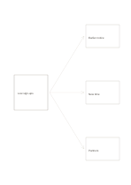

# One problem, three responses

`problem-solution-three` · `causal` · `a5-draft`

[繁體中文](README.zh-TW.md) · [English](README.en.md) · [日本語](README.ja.md) · [Back to catalog](../../docs/en/catalog.md)

Branch one observed problem toward three distinct possible actions, with arrows pointing from the question to the responses.

## When to use it

**Geometry relationship:** `independent` · [converging-flow](../converging-flow/README.en.md)

- List three possible responses to low event sign-ups.
- Keep service troubleshooting options separate before testing them.

## How to use it

1. Name an observable problem in the left box.
2. Put one executable response in each right box without treating hoped-for effects as facts.
3. Compare costs and open questions before choosing a first trial.

## What the page helps you see

Observed outcomes separated from causal hypotheses and unsupported links.

## Worked example

A fictional reading group has low sign-ups; earlier notice, a different time, and partners are three untested responses.

[SVG](examples/en.svg)

## When not to use it

The arrows show options, not evidence that all three responses work or are independent.

## Downloads

- [Wordless SVG](exports/a5-draft/blank.svg)
- [Wordless PDF](exports/a5-draft/blank.pdf)
- [PDF with English name at top left](exports/a5-draft/titled.pdf)
- [Darker-ink wordless PDF](exports/a5-contrast/blank.pdf)
- [Darker-ink SVG](exports/a5-contrast/blank.svg)

The English name appears only on the titled PDF; the wordless version remains available for free writing.

Page size: A5 (148 × 210 mm); profile: `a5-draft`.

## Provenance and status

Generic geometry · Detailed source record: [manifest.json](manifest.json)  
[MIT license scope](../../LICENSE-SCOPE.md)

[Trilingual glossary](../../docs/en/glossary.md)

## Modify and rebuild

Edit geometry in `src/noteformats/variants.py` or text in `src/noteformats/variant_content.py`, then run from the project root:

`python scripts/build.py --ids problem-solution-three`
