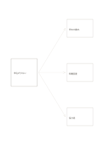

# 一つの問題から三つの対応

`problem-solution-three` · `causal` · `a5-draft`

[繁體中文](README.zh-TW.md) · [English](README.en.md) · [日本語](README.ja.md) · [一覧へ戻る](../../docs/ja/catalog.md)

観察した問題から三つの対応案へ矢印を分け、問いから対策へ進む方向を示します。

## 向いている場面

**図形の対応:** `independent` · [converging-flow](../converging-flow/README.ja.md)

- 催しの申込が少ないときに三つの対応を比べる場合。
- サービスの問題に対する選択肢を試す前に分ける場合。

## 使い方

1. 左の枠に観察できる問題を書きます。
2. 右の三枠に実行できる案を一つずつ書き、期待だけで効果を断定しません。
3. 費用と未確認の条件を比べ、最初の試行を決めます。

## 記入後に見えること

観察結果と原因の仮説を分け、根拠のない関係を示せます。

## 記入例

架空の読書会で申込が少ない場合、早めの案内、時間変更、協力者を未検証の案として並べます。

[SVG](examples/ja.svg)

## 向いていない場面

矢印は選択肢を示すだけで、三案すべての効果や独立性を証明しません。

## ダウンロード

- [文字なしSVG](exports/a5-draft/blank.svg)
- [文字なしPDF](exports/a5-draft/blank.pdf)
- [左上に英語名があるPDF](exports/a5-draft/titled.pdf)
- [濃い線の文字なしPDF](exports/a5-contrast/blank.pdf)
- [濃い線のSVG](exports/a5-contrast/blank.svg)

英語名は表題付きPDFだけに印刷され、文字なし版は自由な記入に使えます。

用紙サイズ：A5（148 × 210 mm）。設定ファイル：`a5-draft`。

## 由来と状態

一般的な幾何構造 · 詳しい由来の記録： [manifest.json](manifest.json)  
[MITライセンスの範囲](../../LICENSE-SCOPE.md)

[三言語の用語集](../../docs/ja/glossary.md)

## 変更と再生成

図形は `src/noteformats/variants.py`、文章は `src/noteformats/variant_content.py` を変更し、プロジェクトのルートで実行します：

`python scripts/build.py --ids problem-solution-three`
