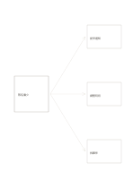

# 一題三解分岔

`problem-solution-three` · `causal` · `a5-draft`

[繁體中文](README.zh-TW.md) · [English](README.en.md) · [日本語](README.ja.md) · [返回目錄](../../docs/zh-TW/catalog.md)

把一個觀察到的問題連向三種不同的處理方案，讓每條箭頭都表示可採取的下一步。

## 適合情境

**幾何對照:** `independent` · [converging-flow](../converging-flow/README.zh-TW.md)

- 活動報名偏少時，並列三種可試的改善方案。
- 服務卡關時，先整理三條互不混淆的處理路徑。

## 使用步驟

1. 在左側寫具體、可觀察的問題。
2. 在右側三框各寫一項可執行的方案，不把猜測寫成已證實的成效。
3. 比較成本與待驗證條件，再決定先試哪一項。

## 整理後可得到

分開觀察結果與原因假設，標出尚無證據的連結。

## 實際填寫示例

虛構讀書會的報名偏少；右側列提早通知、調整時段與找合作夥伴三種待試方案。

[SVG](examples/zh-TW.svg)

## 不適合情境

三條箭頭只是選項，不表示三個方案都有效或彼此獨立。

## 下載

- [無字 SVG](exports/a5-draft/blank.svg)
- [無字 PDF](exports/a5-draft/blank.pdf)
- [左上角英文名稱 PDF](exports/a5-draft/titled.pdf)
- [深色墨線無字 PDF](exports/a5-contrast/blank.pdf)
- [深色墨線 SVG](exports/a5-contrast/blank.svg)

英文名稱只印在標題版 PDF；無字版仍適合自由列印與改作。

頁面尺寸：A5（148 × 210 mm）；設定檔：`a5-draft`。

## 來源與狀態

通用幾何結構 · 詳細來源紀錄見 [manifest.json](manifest.json)  
[MIT 授權範圍](../../LICENSE-SCOPE.md)

[三語術語表](../../docs/zh-TW/glossary.md)

## 修改與重新生成

調整 `src/noteformats/variants.py` 的幾何或 `src/noteformats/variant_content.py` 的文字，再於專案根目錄執行：

`python scripts/build.py --ids problem-solution-three`
