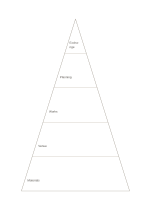

# Five-tier pyramid

`pyramid-five` · `hierarchy` · `a5-draft`

[繁體中文](README.zh-TW.md) · [English](README.en.md) · [日本語](README.ja.md) · [Back to catalog](../../docs/en/catalog.md)

Arrange foundations, actions, and the goal into five tiers and inspect their support. Geometry change: pyramid levels: 5.

## When to use it

**Geometry relationship:** `parameter` · [pyramid-three](../pyramid-three/README.en.md)

- Use five tiers to relate an exhibition's resources, capabilities, activities, outputs and goal.
- Separate notes into five abstraction levels, placing concrete cases below broader claims.

## How to use it

1. Define the hierarchy from foundation to top and keep entries at each level comparable.
2. Use the worked example to place entries in region order: 1: "Exchange"; 2: "Planning"; 3: "Works"; 4: "Venue"; 5: "Materials"
3. Review the regions, mark open questions and choose a next step.

## What the page helps you see

Levels of a goal or topic, with gaps easier to notice.

## Worked example

Entries in example-position order; each number identifies one entry:

1. Exchange
2. Planning
3. Works
4. Venue
5. Materials

[SVG](examples/en.svg)

## When not to use it

Area does not encode population or weight; use a data chart for exact proportions. Small cells hold short phrases rather than long paragraphs.

## Downloads

- [Wordless SVG](exports/a5-draft/blank.svg)
- [Wordless PDF](exports/a5-draft/blank.pdf)
- [PDF with English name at top left](exports/a5-draft/titled.pdf)
- [Darker-ink wordless PDF](exports/a5-contrast/blank.pdf)
- [Darker-ink SVG](exports/a5-contrast/blank.svg)

The English name appears only on the titled PDF; the wordless version remains available for free writing.

Page size: A5 (148 × 210 mm); profile: `a5-draft`.

## Provenance and status

Common geometry · Detailed source record: [manifest.json](manifest.json)  
[MIT license scope](../../LICENSE-SCOPE.md)

[Trilingual glossary](../../docs/en/glossary.md)

## Modify and rebuild

Edit geometry in `src/noteformats/variants.py` or text in `src/noteformats/variant_content.py`, then run from the project root:

`python scripts/build.py --ids pyramid-five`
