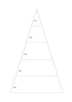

# 五段のピラミッド

`pyramid-five` · `hierarchy` · `a5-draft`

[繁體中文](README.zh-TW.md) · [English](README.en.md) · [日本語](README.ja.md) · [一覧へ戻る](../../docs/ja/catalog.md)

土台、行動、目標を五段に分け、支える関係を確かめます。 図形の変更： ピラミッドの段数: 5.

## 向いている場面

**図形の対応:** `parameter` · [pyramid-three](../pyramid-three/README.ja.md)

- 展示の資源・能力・活動・成果物・目的の支え合いを五段に整理するとき。
- 記録を五つの抽象度に分け、具体例を下へ、概括的な主張を上へ置くとき。

## 使い方

1. 土台から上へ階層の意味を決め、各段に同じ尺度の項目を書きます。
2. 記入例を参考に、領域の順で記します：1「交流」；2「企画」；3「作品」；4「会場」；5「材料」
3. 各領域を読み返し、未確認の点と次の行動を記します。

## 記入後に見えること

目的や話題の階層と、抜けている要素が見えます。

## 記入例

図の記入位置の順に示します。番号一つが一つの記入例です：

1. 交流
2. 企画
3. 作品
4. 会場
5. 材料

[SVG](examples/ja.svg)

## 向いていない場面

面積は人数や重みを示しません。正確な割合はデータの図表で示してください。 小さなマスは短い語句向けで、長い文章には向きません。

## ダウンロード

- [文字なしSVG](exports/a5-draft/blank.svg)
- [文字なしPDF](exports/a5-draft/blank.pdf)
- [左上に英語名があるPDF](exports/a5-draft/titled.pdf)
- [濃い線の文字なしPDF](exports/a5-contrast/blank.pdf)
- [濃い線のSVG](exports/a5-contrast/blank.svg)

英語名は表題付きPDFだけに印刷され、文字なし版は自由な記入に使えます。

用紙サイズ：A5（148 × 210 mm）。設定ファイル：`a5-draft`。

## 由来と状態

一般的な幾何構造 · 詳しい由来の記録： [manifest.json](manifest.json)  
[MITライセンスの範囲](../../LICENSE-SCOPE.md)

[三言語の用語集](../../docs/ja/glossary.md)

## 変更と再生成

図形は `src/noteformats/variants.py`、文章は `src/noteformats/variant_content.py` を変更し、プロジェクトのルートで実行します：

`python scripts/build.py --ids pyramid-five`
