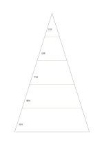

# 五層金字塔

`pyramid-five` · `hierarchy` · `a5-draft`

[繁體中文](README.zh-TW.md) · [English](README.en.md) · [日本語](README.ja.md) · [返回目錄](../../docs/zh-TW/catalog.md)

把基礎條件、行動與上層目標分成五層，檢查支撐關係。 本款的幾何變化： 金字塔層數: 5.

## 適合情境

**幾何對照:** `parameter` · [pyramid-three](../pyramid-three/README.zh-TW.md)

- 以五層整理展覽從基礎資源、能力、活動、產出到目標的支撐關係。
- 區分五種抽象層次的筆記，將具體事例放在較下層、概括主張放在較上層。

## 使用步驟

1. 先決定由基礎到上層的層級意義，每層只寫同一尺度的項目。
2. 參考本頁示例，各區依序記錄：1「交流」；2「企劃」；3「作品」；4「場地」；5「材料」
3. 回看各區，標記仍待查證的內容，再決定下一步。

## 整理後可得到

區分上位目標與下位要素，檢查是否遺漏。

## 實際填寫示例

依圖中填寫位置順序列出，每個編號是一筆示例條目：

1. 交流
2. 企劃
3. 作品
4. 場地
5. 材料

[SVG](examples/zh-TW.svg)

## 不適合情境

面積差不表示人數或權重；若要比較精確比例，應用數據圖表。 細小格子只宜短語，不適合長篇段落。

## 下載

- [無字 SVG](exports/a5-draft/blank.svg)
- [無字 PDF](exports/a5-draft/blank.pdf)
- [左上角英文名稱 PDF](exports/a5-draft/titled.pdf)
- [深色墨線無字 PDF](exports/a5-contrast/blank.pdf)
- [深色墨線 SVG](exports/a5-contrast/blank.svg)

英文名稱只印在標題版 PDF；無字版仍適合自由列印與改作。

頁面尺寸：A5（148 × 210 mm）；設定檔：`a5-draft`。

## 來源與狀態

通用幾何結構 · 詳細來源紀錄見 [manifest.json](manifest.json)  
[MIT 授權範圍](../../LICENSE-SCOPE.md)

[三語術語表](../../docs/zh-TW/glossary.md)

## 修改與重新生成

調整 `src/noteformats/variants.py` 的幾何或 `src/noteformats/variant_content.py` 的文字，再於專案根目錄執行：

`python scripts/build.py --ids pyramid-five`
