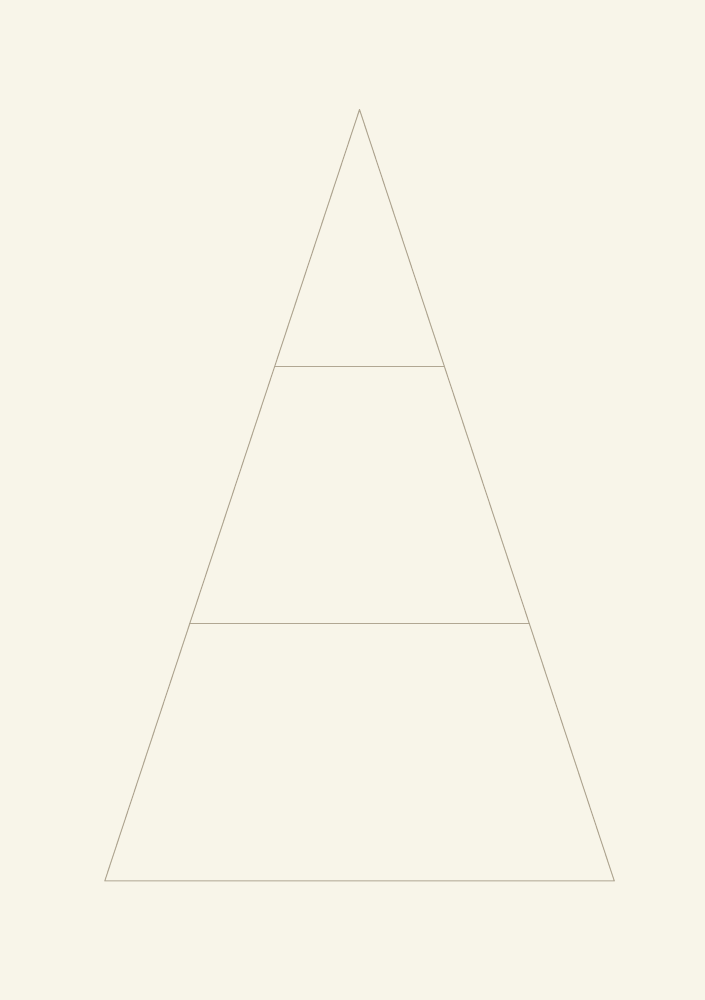
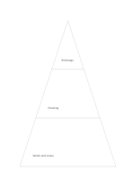

# Three-tier pyramid

`pyramid-three` · `hierarchy` · `a5-draft`

[繁體中文](README.zh-TW.md) · [English](README.en.md) · [日本語](README.ja.md) · [Back to catalog](../../docs/en/catalog.md)

Arrange a concept as a broad base, a middle practice, and a concise top goal.

## When to use it

- Explain which resources support an event goal.
- Outline an argument from observations through inference to claim.

## How to use it

1. Define what the three levels mean; position alone does not prove value.
2. Fill the wide base before the more condensed middle and top.
3. Check whether each upper statement is supported by the level beneath.

## What the page helps you see

Levels of a goal or topic, with gaps easier to notice.

## Worked example

A fictional exhibition has works and venue at the base, curatorial planning in the middle, and community exchange at the top.

[SVG](examples/en.svg)

## When not to use it

Area does not encode population or weight; use a data chart for exact proportions.

## Downloads

- [Wordless SVG](exports/a5-draft/blank.svg)
- [Wordless PDF](exports/a5-draft/blank.pdf)
- [PDF with English name at top left](exports/a5-draft/titled.pdf)
- [Darker-ink wordless PDF](exports/a5-contrast/blank.pdf)
- [Darker-ink SVG](exports/a5-contrast/blank.svg)

The English name appears only on the titled PDF; the wordless version remains available for free writing.

Page size: A5 (148 × 210 mm); profile: `a5-draft`.

## Provenance and status

Common geometry · Detailed source record: [manifest.json](manifest.json)  
[MIT license scope](../../LICENSE-SCOPE.md)

[Trilingual glossary](../../docs/en/glossary.md)

## Modify and rebuild

Change `profiles/a5-draft.json` or the corresponding builder in `src/noteformats/layouts/`, then run from the project root:

`python scripts/build.py --ids pyramid-three`
