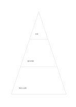

# 三段のピラミッド

`pyramid-three` · `hierarchy` · `a5-draft`

[繁體中文](README.zh-TW.md) · [English](README.en.md) · [日本語](README.ja.md) · [一覧へ戻る](../../docs/ja/catalog.md)

広い土台、中段の方法、上段の目標など、概念を三層に整理します。

## 向いている場面

- 催しの目標を支える資源を説明するとき。
- 観察から推論、主張へ進む論証を整理するとき。

## 使い方

1. 三層の意味を先に決め、位置だけで価値の上下を決めません。
2. 広い土台から、中段と上段へ内容を絞って書きます。
3. 上段が下段に支えられているか確かめます。

## 記入後に見えること

目的や話題の階層と、抜けている要素が見えます。

## 記入例

架空の展示で、下段に作品と会場、中段に展示計画、上段に地域の交流という目的を置きます。

[SVG](examples/ja.svg)

## 向いていない場面

面積は人数や重みを示しません。正確な割合はデータの図表で示してください。

## ダウンロード

- [文字なしSVG](exports/a5-draft/blank.svg)
- [文字なしPDF](exports/a5-draft/blank.pdf)
- [左上に英語名があるPDF](exports/a5-draft/titled.pdf)
- [濃い線の文字なしPDF](exports/a5-contrast/blank.pdf)
- [濃い線のSVG](exports/a5-contrast/blank.svg)

英語名は表題付きPDFだけに印刷され、文字なし版は自由な記入に使えます。

用紙サイズ：A5（148 × 210 mm）。設定ファイル：`a5-draft`。

## 由来と状態

一般的な幾何構造 · 詳しい由来の記録： [manifest.json](manifest.json)  
[MITライセンスの範囲](../../LICENSE-SCOPE.md)

[三言語の用語集](../../docs/ja/glossary.md)

## 変更と再生成

`profiles/a5-draft.json` または `src/noteformats/layouts/` の描画関数を変更し、プロジェクトのルートで実行します：

`python scripts/build.py --ids pyramid-three`
