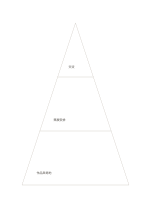

# 三層金字塔

`pyramid-three` · `hierarchy` · `a5-draft`

[繁體中文](README.zh-TW.md) · [English](README.en.md) · [日本語](README.ja.md) · [返回目錄](../../docs/zh-TW/catalog.md)

把一個概念拆成底層基礎、中層做法與頂層目標等三層。

## 適合情境

- 解釋活動目標依賴哪些基礎資源。
- 整理論證由資料到推論再到主張的層次。

## 使用步驟

1. 先自行定義三層的含義，避免把位置誤當價值高低。
2. 從較寬的底層寫基礎，再向上填入較濃縮的內容。
3. 逐層檢查上層是否真有下層支持。

## 整理後可得到

區分上位目標與下位要素，檢查是否遺漏。

## 實際填寫示例

虛構展覽在底層記作品與場地，中層記策展安排，頂層記讓社區交流的目標。

[SVG](examples/zh-TW.svg)

## 不適合情境

面積差不表示人數或權重；若要比較精確比例，應用數據圖表。

## 下載

- [無字 SVG](exports/a5-draft/blank.svg)
- [無字 PDF](exports/a5-draft/blank.pdf)
- [左上角英文名稱 PDF](exports/a5-draft/titled.pdf)
- [深色墨線無字 PDF](exports/a5-contrast/blank.pdf)
- [深色墨線 SVG](exports/a5-contrast/blank.svg)

英文名稱只印在標題版 PDF；無字版仍適合自由列印與改作。

頁面尺寸：A5（148 × 210 mm）；設定檔：`a5-draft`。

## 來源與狀態

通用幾何結構 · 詳細來源紀錄見 [manifest.json](manifest.json)  
[MIT 授權範圍](../../LICENSE-SCOPE.md)

[三語術語表](../../docs/zh-TW/glossary.md)

## 修改與重新生成

修改 `profiles/a5-draft.json` 或 `src/noteformats/layouts/` 內對應的繪圖函式，再於專案根目錄執行：

`python scripts/build.py --ids pyramid-three`
