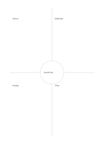

# Four sectors with central synthesis

`quadrant-center-circle` · `matrix` · `a5-draft`

[繁體中文](README.zh-TW.md) · [English](README.en.md) · [日本語](README.ja.md) · [Back to catalog](../../docs/en/catalog.md)

Sort four perspectives and place a shared conclusion in the center circle.

## When to use it

- Combine four participant views of an event need.
- Look for a common issue across four observation types.

## How to use it

1. Assign a different perspective to each outer sector.
2. Add short statements and information still to verify.
3. Put only a genuinely shared conclusion or next question in the center.

## What the page helps you see

Intersections, missing cells, and tradeoffs across chosen dimensions.

## Worked example

A fictional reading group puts venue, materials, people, and timing outside, with a shared decision to run a small trial in the middle.

[SVG](examples/en.svg)

## When not to use it

The center is too small for a long summary; forcing unrelated sectors into agreement can mislead.

## Downloads

- [Wordless SVG](exports/a5-draft/blank.svg)
- [Wordless PDF](exports/a5-draft/blank.pdf)
- [PDF with English name at top left](exports/a5-draft/titled.pdf)
- [Darker-ink wordless PDF](exports/a5-contrast/blank.pdf)
- [Darker-ink SVG](exports/a5-contrast/blank.svg)

The English name appears only on the titled PDF; the wordless version remains available for free writing.

Page size: A5 (148 × 210 mm); profile: `a5-draft`.

## Provenance and status

Original layout · Detailed source record: [manifest.json](manifest.json)  
[MIT license scope](../../LICENSE-SCOPE.md)

[Trilingual glossary](../../docs/en/glossary.md)

## Modify and rebuild

Change `profiles/a5-draft.json` or the corresponding builder in `src/noteformats/layouts/`, then run from the project root:

`python scripts/build.py --ids quadrant-center-circle`
