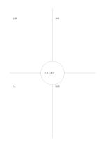

# 中心で統合する四象限

`quadrant-center-circle` · `matrix` · `a5-draft`

[繁體中文](README.zh-TW.md) · [English](README.en.md) · [日本語](README.ja.md) · [一覧へ戻る](../../docs/ja/catalog.md)

四つの観点を分け、共通する結論を中央の円に置きます。

## 向いている場面

- 催しについて四種類の参加者の見方をまとめるとき。
- 四種類の観察から共通の課題を探すとき。

## 使い方

1. 外側の四領域に異なる観点を割り当てます。
2. 各領域に短い記述と確認事項を書きます。
3. 四領域で本当に共有できる結論か次の問いだけを中央に置きます。

## 記入後に見えること

複数の観点が交わる場所と、空白や選択上の差が見えます。

## 記入例

架空の読書会で会場、材料、人、時間を外に置き、中央に小規模で試すという共通決定を書いています。

[SVG](examples/ja.svg)

## 向いていない場面

中央は小さく長い要約は入りません。無関係な四領域を無理に統合すると誤解を招きます。

## ダウンロード

- [文字なしSVG](exports/a5-draft/blank.svg)
- [文字なしPDF](exports/a5-draft/blank.pdf)
- [左上に英語名があるPDF](exports/a5-draft/titled.pdf)
- [濃い線の文字なしPDF](exports/a5-contrast/blank.pdf)
- [濃い線のSVG](exports/a5-contrast/blank.svg)

英語名は表題付きPDFだけに印刷され、文字なし版は自由な記入に使えます。

用紙サイズ：A5（148 × 210 mm）。設定ファイル：`a5-draft`。

## 由来と状態

本プロジェクトの独自レイアウト · 詳しい由来の記録： [manifest.json](manifest.json)  
[MITライセンスの範囲](../../LICENSE-SCOPE.md)

[三言語の用語集](../../docs/ja/glossary.md)

## 変更と再生成

`profiles/a5-draft.json` または `src/noteformats/layouts/` の描画関数を変更し、プロジェクトのルートで実行します：

`python scripts/build.py --ids quadrant-center-circle`
