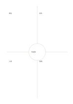

# 中心整合四象限

`quadrant-center-circle` · `matrix` · `a5-draft`

[繁體中文](README.zh-TW.md) · [English](README.en.md) · [日本語](README.ja.md) · [返回目錄](../../docs/zh-TW/catalog.md)

先分四區整理觀點，再把共同結論放進中央圓。

## 適合情境

- 從四種參與者角度整合一個活動需求。
- 比較四類觀察後找出共同問題。

## 使用步驟

1. 先替四個區域各決定一個觀點。
2. 在各區放短句與尚待查證的資訊。
3. 只把四區都支持的結論或下一個共同問題寫在中央圓。

## 整理後可得到

看見兩個以上維度交叉處的資料缺口與取捨。

## 實際填寫示例

示例把虛構讀書會的場地、材料、人員、時間放四區，中央寫共同的『先試辦』決定。

[SVG](examples/zh-TW.svg)

## 不適合情境

中央圓很小，不能當長篇總結；若四區彼此無關，強迫整合會失真。

## 下載

- [無字 SVG](exports/a5-draft/blank.svg)
- [無字 PDF](exports/a5-draft/blank.pdf)
- [左上角英文名稱 PDF](exports/a5-draft/titled.pdf)
- [深色墨線無字 PDF](exports/a5-contrast/blank.pdf)
- [深色墨線 SVG](exports/a5-contrast/blank.svg)

英文名稱只印在標題版 PDF；無字版仍適合自由列印與改作。

頁面尺寸：A5（148 × 210 mm）；設定檔：`a5-draft`。

## 來源與狀態

本專案原創版面 · 詳細來源紀錄見 [manifest.json](manifest.json)  
[MIT 授權範圍](../../LICENSE-SCOPE.md)

[三語術語表](../../docs/zh-TW/glossary.md)

## 修改與重新生成

修改 `profiles/a5-draft.json` 或 `src/noteformats/layouts/` 內對應的繪圖函式，再於專案根目錄執行：

`python scripts/build.py --ids quadrant-center-circle`
