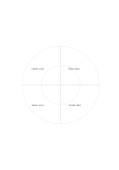

# Quadrants with rings

`quadrant-rings` · `matrix` · `a5-draft`

[繁體中文](README.zh-TW.md) · [English](README.en.md) · [日本語](README.ja.md) · [Back to catalog](../../docs/en/catalog.md)

Classify by direction and by two levels of distance or priority at once.

## When to use it

- Compare near and far observations in four directions.
- Split four work categories into sooner and later layers.

## How to use it

1. Define what each of the four directions means.
2. Decide whether inner and outer rings represent distance or priority.
3. Place items in sectors and revisit those near a boundary.

## What the page helps you see

Intersections, missing cells, and tradeoffs across chosen dimensions.

## Worked example

A fictional community garden uses four directions; inner cells hold near-term tasks and outer cells matters requiring coordination.

[SVG](examples/en.svg)

## When not to use it

Ring area does not encode quantity, and crowded sectors lose clarity.

## Downloads

- [Wordless SVG](exports/a5-draft/blank.svg)
- [Wordless PDF](exports/a5-draft/blank.pdf)
- [PDF with English name at top left](exports/a5-draft/titled.pdf)
- [Darker-ink wordless PDF](exports/a5-contrast/blank.pdf)
- [Darker-ink SVG](exports/a5-contrast/blank.svg)

The English name appears only on the titled PDF; the wordless version remains available for free writing.

Page size: A5 (148 × 210 mm); profile: `a5-draft`.

## Provenance and status

Original layout · Detailed source record: [manifest.json](manifest.json)  
[MIT license scope](../../LICENSE-SCOPE.md)

[Trilingual glossary](../../docs/en/glossary.md)

## Modify and rebuild

Change `profiles/a5-draft.json` or the corresponding builder in `src/noteformats/layouts/`, then run from the project root:

`python scripts/build.py --ids quadrant-rings`
